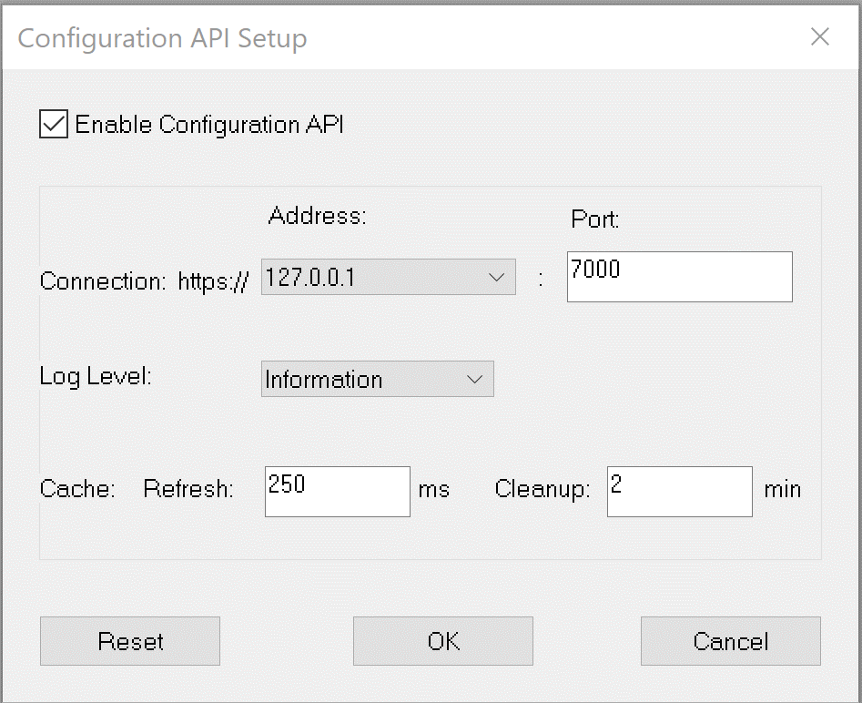

# Configuration API Setup

The [Configuration API](index.md) is set up in the Configuration API Setup dialog box. To open it, select **Tools** > **Configuration API Setup** > **Configuration API Setup**.

!!! note
    This screenshot was taken before the **SSL Certificate**, **Key / Password** and authentication settings were added to the dialog box.

Select **Enable Configuration API** to enable the API and its settings. The API is disabled by default.

| Setting | Description |
|---|---|
| **Enable Configuration API** | Turns the API on. When it is on, the API starts and stops with System Monitor. |
| **Connection: https:// Address** | The IP address that the API listens on for connecting clients. Select `127.0.0.1` (the default) to accept connections from this PC only, or one of the PC's own IP addresses to accept connections over the network. |
| **Port** | The port that the API listens on. The default is 7000. |
| **SSL Certificate** | The certificate file used for HTTPS connections. Click **...** to browse for it. If no certificate is set, a default development certificate is used and the status bar shows **NO CERT**. |
| **Key / Password** | For a `.pem` certificate, the private key file (click **...** to browse for it). For other certificate files, the certificate password. |
| **Log Level** | The amount of detail written to the API log file: **Trace**, **Debug**, **Information** (the default), **Warning**, **Error** or **Fatal**. At **Debug**, every request to the API is also logged, with the time taken to process it. |
| **Cache: Refresh** | How often, in milliseconds, cached measurement parameter values are updated. The default is 250 ms. |
| **Cache: Cleanup** | How often, in minutes, parameters that have not been requested for a minute are removed from the cache. The default is 2 min. |
| **Enable Authentication** | Requires clients to present an access token (JWT bearer token) with each request. |
| **Authority URI** | The token issuer that the API accepts. Available when **Enable Authentication** is selected. |
| **Audience URI** | The token audience that the API accepts. Available when **Enable Authentication** is selected. |
| **Reset** | Returns the address, port, log level and cache settings to their default values. The certificate and authentication settings are not changed. |

The cache is used for requests for the values of more than five measurement parameters at once. Set **Refresh** or **Cleanup** to 0 to turn caching off.

When you click **OK** after changing any setting, a message tells you that System Monitor must be restarted before the changes take effect. Alternatively, restart the API with the new settings by selecting **Tools** > **Configuration API Setup** > **Configuration API Reset**.

**See also:** [Configuration API](index.md); [Protocol Documentation](protocol-documentation.md)
