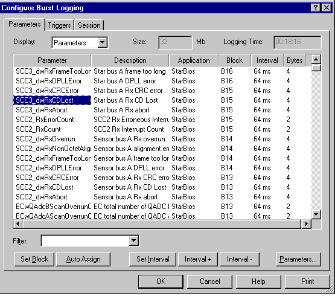
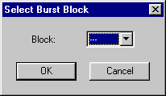
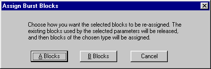
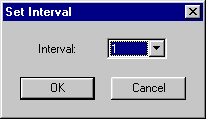

# Burst Logging - Parameters tab

Use the Parameters tab of the Configure Burst Logging dialog box to select the parameters to be logged in the Burst Memory, and to assign them to blocks and logging intervals.

The Parameters tab has the following areas:

- [Display control](#display-control) - Determines how the parameter list is displayed.
- [Size and Logging Time display](#size-and-logging-time-display) - Displays the memory size and the time to fill the memory.
- [Parameters list](#parameters-list) - Displays the parameters to be logged.
- [Controls](#controls) - Assign parameters to blocks, set parameter intervals and add or remove parameters.

## Display control

The **Display** drop-down list determines how the parameter list is displayed. The options are:

- **Parameters** - Shows all the selected parameters, with a row for each one.
- **A Blocks** - Shows all the available A blocks, with a row for each one.
- **B Blocks** - Shows all the available B blocks, with a row for each one.

## Size and Logging Time display

The following information is displayed:

- **Size** - The size, in Mb, of the [Logging Memory](../logging-memory-allocation.md) in the ECU. This is taken from the unit's program version.
- **Logging time** - The duration (hours:minutes:seconds) of logging that will fill the memory. It is calculated from the [Logging Intervals](burst-logging-intervals.md) and the Size of the memory.
    - When Parameters is selected in the Display drop-down list, the logging time is calculated from the parameter intervals.
    - When A Blocks or B Blocks is selected, the logging time is calculated from the block intervals, even if the blocks do not have any parameters assigned to them.

## Parameters list

The list has the following columns:

| Column | Description |
|---|---|
| **Parameter** | The parameter name. Only shown when Parameters is selected in the Display drop-down list. |
| **Description** | The parameter description. Only shown when Parameters is selected. |
| **Application** | The Application associated with the parameter. Only shown when Parameters is selected. |
| **Block** | The block to which the parameter is assigned (see [Burst Logging - Blocks](burst-logging-blocks.md)). --- indicates that the parameter is not assigned to a block. |
| **Interval** | The sampling interval for the parameter (see [Burst Logging - Intervals](burst-logging-intervals.md)). When a parameter is assigned to an empty block, the interval is set to the lowest available value. --- indicates that logging is disabled for the parameter. |
| **Bytes** | The size of the parameter in bytes. Only shown when Parameters is selected. |
| **Bytes Available** | The space, in bytes, available for assigning parameters. Only shown when A Blocks or B Blocks is selected. |

The Parameter, Description and Application columns can be shown or hidden using the context menu.

### Adding parameters

Click **Parameters...** to open the [Select Multiple Parameters](../../../using-system-monitor/parameters/selecting-parameters/selecting-multiple-parameters.md) dialog box. Use it to add and remove parameters. The number of parameters that you can add depends on their size and on how they are assigned to blocks (see [Burst Logging - Blocks](burst-logging-blocks.md)).

If the list is empty when parameters are added, use **Auto Assign** to place all the parameters in blocks. If the list is not empty, the new parameters are added using the following rules of precedence as the available space is filled:

1. Same block as the currently selected parameter.
2. New block of the same type (A or B) at the same interval.
3. Other type of block at the same interval.
4. Same type of block at a higher interval.
5. Other type of block at a higher interval.
6. Not assigned.

If A Blocks or B Blocks is selected in the Display drop-down list, and one or more blocks are selected, the parameters are assigned to the selected blocks.

### Other features

- Filter the parameter list using the **Filter** box (see [Parameter Filter](../../../using-system-monitor/parameters/selecting-parameters/parameter-filter.md)).
- Select more than one parameter or block using the SHIFT and CTRL keys.
- Delete the selected parameters by pressing the DELETE key.

## Controls

The following controls operate on the selected parameters or blocks.

### Set Block

Opens the **Select Burst Block** dialog box. Only available if Parameters is selected in the Display drop-down list.

The **Block** drop-down list shows all the blocks that have enough space for the selected parameters. Click **OK** to assign the selected parameters to the selected block.

If --- is selected, the block assignment is removed and --- is shown in the Block column. The parameter is not logged.

### Auto Assign

Opens the **Assign Burst Blocks** dialog box. Only available if Parameters is selected in the Display drop-down list.

Click **A Blocks** or **B Blocks**. The blocks currently used by the selected parameters are released, and the parameters are then assigned (in the order in which they appear in the list) to blocks of the chosen type, in numerical order of blocks. If you have selected parameters from more than one unit, they cannot share a block; Auto Assign handles this for you.

### Set Interval

Opens the **Set Interval** dialog box.

Select a value from the **Interval** drop-down list and click **OK** to set the selected items to that interval. The intervals double from the lowest available value (see [Burst Logging - Intervals](burst-logging-intervals.md)) up to 16384 ms.

- The interval applies to a complete block. The intervals of parameters that share a block with the selected parameters are also changed.
- The interval can be set to ---, which prevents the parameter from being logged while keeping its block assignment.
- Set Interval only operates on parameters that are assigned to blocks.
- If A Blocks or B Blocks is selected in the Display drop-down list, the interval is applied to the selected block or blocks. The blocks do not have to have any parameters assigned to them.

### Interval + / Interval -

Increase or decrease the interval of the selected parameters to the next valid interval. This only operates on parameters that are assigned to blocks and do not have an interval of ---.

You can also use the plus and minus keys on the numeric keypad.

### Parameters...

Opens the Select Multiple Parameters dialog box. Use it to add parameters to, or remove parameters from, the list.

**See also:** [Burst Logging - Blocks](burst-logging-blocks.md); [Burst Logging - Intervals](burst-logging-intervals.md)
