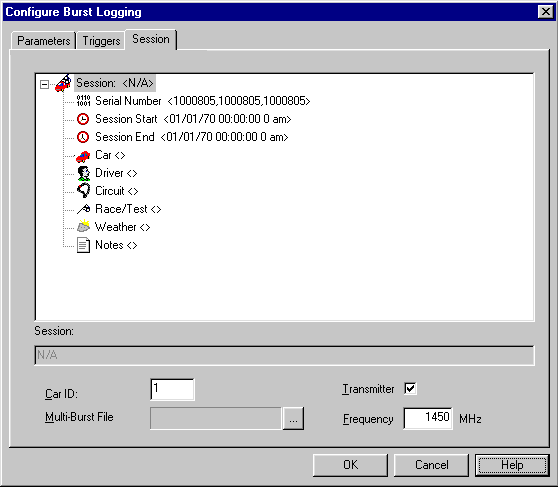

# Burst Logging - Session tab

Use the Session tab of the Configure Burst Logging dialog box to edit the characteristics of the [Session](../sessions-and-telemetry.md) that is created when the contents of the Burst Memory are uploaded or transmitted to ATLAS. See [Session Details](../session-details.md) for information on editing the entries.

!!! note
    The Session tab is not shown on units whose BIOS configures telemetry. The session details are then configured in the Data Version.

For ECUs that use Burst memory for [Wide Band Telemetry](../sessions-and-telemetry.md), the following controls are available:

| Control | Description |
|---|---|
| **Unit ID** | An ID number that distinguishes the car from other cars (for example, cars in the same team using the same telemetry system). The number must match the ID of the car. It is an integer from 1 to 4. |
| **Transmitter** | When selected, the transmission of data by telemetry is enabled. |
| **Frequency** | The radio frequency of the transmitter, in MHz, if the transmitter is software configurable. Ensure that the value is within the operating range of the transmitter. |
| **Multi-Burst File** | Some versions of ATLAS can configure the retransmission of data in multi-burst telemetry. If your version of ATLAS has this facility, it generates a Multi-Burst Coverage file (\*.mbc). Click **...** to browse for the file. The coverage data is downloaded to the ECU with the logging configuration. If you do not have a Multi-Burst Coverage file, this field is empty. |

**See also:** [Burst Logging](index.md); [Session Details](../session-details.md)
