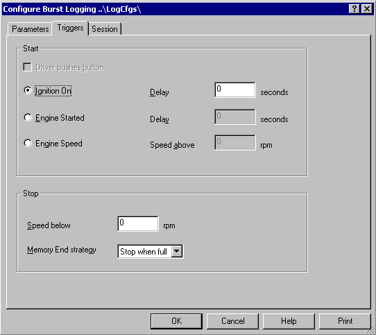

# Burst Logging - Triggers tab

Use the Triggers tab of the Configure Burst Logging dialog box to set the trigger conditions that start and stop data logging.

## Start panel

**Driver pushes button** - When selected, logging starts when the driver presses the control button that is configured for use with data logging. This is selected by default. It is only available if the unit supports a driver button; if it does not, the check box is unavailable and **Ignition On** is used.

When the **Driver pushes button** check box is cleared, select one of the following options:

- **Ignition On** - Logging starts when the ignition is switched on, after the **Delay** entered. The delay can be from 0 to 120 seconds, to a resolution of 0.1 seconds. The default is 0.
- **Engine Started** - Logging starts when the engine is started, after the **Delay** entered. The delay can be from 0 to 120 seconds, to a resolution of 0.1 seconds. The default is 0.
- **Engine Speed** - Logging starts when the engine speed exceeds the **Speed above** value. Enter the speed as an integer from 0 to 20000 rpm. The default is 0.

In a new configuration, Engine Speed is the option selected under Driver pushes button.

## Stop panel

- **Speed below** - Logging stops when the engine speed falls below this value. Enter the speed as an integer from 0 to 20000 rpm. The default is 0.
- **Memory End strategy** - Two strategies are available:
    - **Stop when full** - Data is logged from the start trigger until either the stop trigger occurs or the ECU memory is full. This is the default.
    - **Wrap** - Data is logged from the start trigger until the stop trigger occurs. If the available memory is exceeded, new data overwrites the oldest data in the memory, so the memory always contains the most recent logged data. Use this strategy if you want to analyse data leading up to a specific event.

**See also:** [Burst Logging](index.md)
