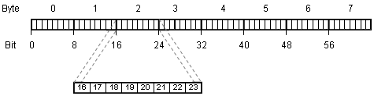
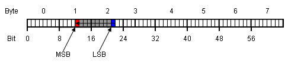
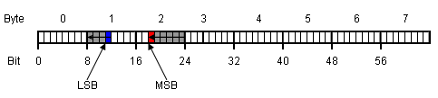
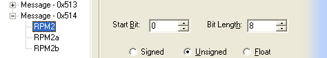

# CAN Bit Definitions

For each measurement parameter and multiplexer value, the start bit, length and byte order must be defined. The bits and bytes in a CAN message are numbered sequentially from left to right. A classic CAN message has up to 8 bytes (bits 0 to 63); a CAN FD message has up to 64 bytes (bits 0 to 511).

## MSB First format values

When a measurement parameter or multiplexer value is defined as MSB First, the start bit defines the location of the most significant bit. The progression of bits and bytes is to the right. The following diagram shows an MSB First 10-bit value starting at bit 12.

## MSB Last format values

When a measurement parameter or multiplexer value is defined as MSB Last, the start bit defines the location of the least significant bit. The progression of bits is to the left and the progression of bytes is to the right. The following diagram shows an MSB Last 10-bit value starting at bit 11.

!!! note
    In an MSB Last word, the start bit is the last bit of the first byte. Although the start bit of a word at the start of a CAN message is bit 0, its start bit in MSB terms is bit 7. When a parameter is added to a CAN message, the CAN Configuration dialog box displays normalised start bit values (see [Parameter Details](can-configuration-dialog-box/parameter-details.md)). For example, if the parameter is at the start of a CAN message, the Start Bit box shows 0, although the underlying value is 7. The start bit of a second parameter is shown as 8, although its underlying value is 15, and so on.

    

    In the v2 CSV format used by [Export](import-export-buffers-and-messages.md), MSB Last start bits are written as the logical (normalised) bit position.
