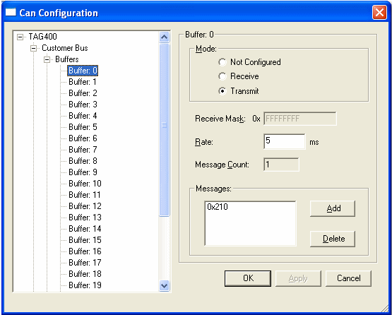

# Buffers

With a buffer selected, the options apply to that buffer only.

!!! note
    The CAN messages associated with the buffer are listed under the Messages node for the CAN bus.

Add a CAN message to a buffer:

1. Select a buffer.
2. Click **Add**.
3. In the **Add Message Id** dialog box, select a message ID from the list and click **OK**.

The CAN message is assigned to the selected buffer. When a message is selected in the explorer, the buffer to which it is assigned is shown in the [Message Details](message-details.md). A CAN message can only be assigned to one buffer.

!!! note
    Buffers can be configured individually as described above, or existing buffer configurations can be imported. Right-click the Buffers node and select **Import Buffers...** or **Export Buffers...**. See [Import/Export Buffers and Messages](../import-export-buffers-and-messages.md).

## Mode panel

Defines the mode of the CAN messages configured for the buffer:

- **Not Configured** - Messages configured for this buffer are not included in the logging.
- **Receive** - The CAN messages are received.
- **Transmit** - The CAN messages are transmitted.
- **Reserved** - The buffer is reserved and cannot be configured. This option may not be available for every buffer.

## Buffer panel

- **Receive Mask** - Any bits that are zero in the Receive Mask are ignored when comparing the ID of a received data frame with the acceptance ID of the buffer. For example, if the receive mask is 0xFFFFFFF0 and the ID of the first message is 0x210, the buffer receives all messages in the range 0x210 to 0x21F. Not all buffers have a configurable receive mask.
- **Rate** - The time between each message being transmitted, in ms.
- **Message Count** - The number of CAN messages configured for the buffer. Read only.

## Messages panel

Lists the IDs of the CAN messages configured for the buffer.

- **Add** - Add a CAN message to the buffer.
- **Delete** - Delete the selected message ID from the buffer.

To configure the messages themselves, select the Messages node. See [CAN Messages](messages.md).
