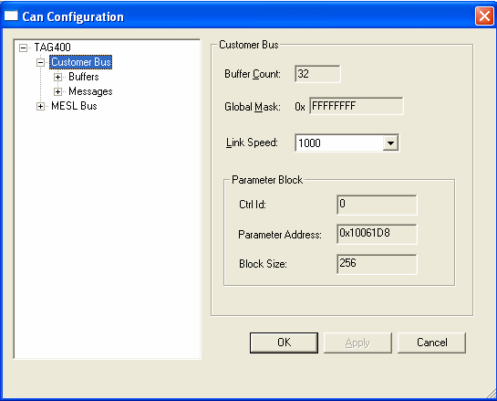
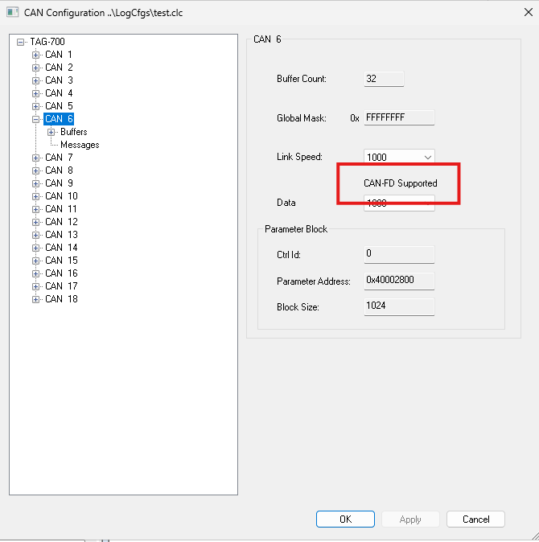

# CAN Bus

With a CAN bus selected in the explorer, the options apply to all the buffers and associated CAN messages on that bus.

Expanding the bus node displays the Buffers and Messages configured for the bus.

The options are as follows:

| Option | Description |
|---|---|
| **Buffer Count** | The number of buffers available for configuration on the selected bus. Read only. |
| **Global Mask** | The receive mask for all the buffers that do not have a configurable Receive Mask. Read only. Not all control units support a configurable global mask. |
| **Link Speed** | Select the speed of the bus, in kbit/s, from the drop-down list. On CAN FD buses this is the arbitration-phase bit rate. |
| **CAN-FD Supported** | Shown only when the bus supports CAN FD. |
| **Data Speed** | The CAN FD data-phase bit rate. Only available when the bus supports CAN FD. The speeds offered are defined by the unit. |

## Parameter Block panel

Received measurement parameters for the CAN bus are stored in a single contiguous block of memory. The following read-only data defines the memory area:

- **Ctrl Id** - The controller ID of the memory block.
- **Parameter Address** - The start address of the memory block.
- **Block Size** - The size of the memory block.

To configure buffers, expand the Buffers node and select a buffer. See [Buffers](buffers.md).
