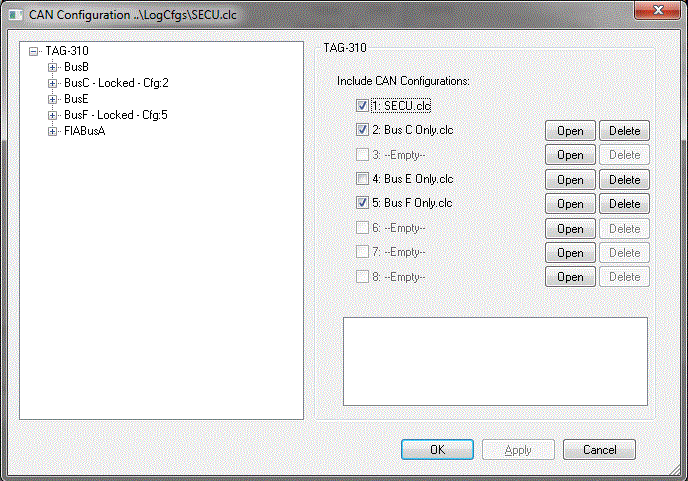
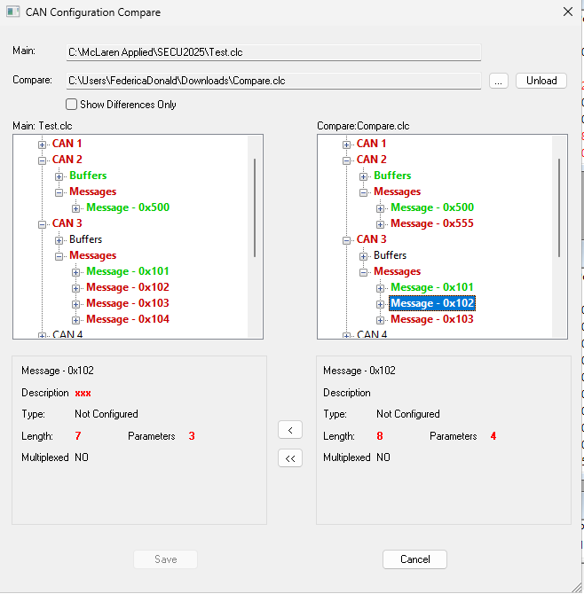

# CAN Configuration Dialog Box

The CAN Configuration dialog box is used to configure:

- **transmit** CAN messages for logging by an **external** unit
- **receive** CAN messages for logging **internally** using the CAN buffers

To open the dialog box select **Logging** > **CAN Configuration...** (CTRL+F8).

!!! note
    If the CAN Configuration menu item is not available, you must create a new CAN Configuration file (.clc) or open an existing one. See [Creating New Files](../../../../project-management/files/creating-new-files.md) and [Opening Files](../../../../project-management/files/opening-files.md).

    When a new CAN Configuration file is added to the project, no CAN messages are configured. Messages can be configured manually or imported from existing files. See [Import/Export Buffers and Messages](../import-export-buffers-and-messages.md).

    Creating or adding a CAN Configuration file adds a CAN Parameters folder to the System Monitor Explorer. This folder contains the CAN parameters configured in the ECU, which can be associated with CAN **Receive** messages. See [CAN Parameters](../can-parameters.md).

## Including CAN configurations

Select the unit (the top node of the tree) to show the **Include CAN Configurations** list. Up to 16 CAN configuration files can be listed. They are merged to create a single configuration.

- The first entry is the main configuration of the project and must exist.
- Click **Open** to load a further configuration file into a slot, and **Delete** to remove it.
- Select the check box of each configuration to include it.
- Any errors from merging the selected configurations are displayed below the list.
- Click **Checksum** to open the CAN Checksum dialog box, which shows the checksum of the configurable CAN configuration and, where applicable, of the FIA configuration.

Depending on the project, the FIA can sanction the use of an FIA-supplied CAN configuration. On units that support this, a column of **FIA** check boxes is shown next to the list. Select the FIA check box of a configuration to include it in the logging configuration as a separate, locked entity.

Right-click the unit node for **Import CAN DBC Configuration...** and **Export CAN DBC Configuration...**. When importing a DBC file, the DBC Import Bus selection dialog box lets you set the destination bus for each node, show the messages, select all items and choose whether to **Merge** the imported data with the existing configuration.

## CAN Configuration explorer

The tree on the left shows the CAN buses configured for the connected unit:

- The unit type is shown at the top with the available CAN buses listed below it.
- The buses available are defined in the ASAP file.
- A bus that is part of a locked (FIA) configuration is labelled as locked.

The options on the right depend on the item selected in the tree:

- [Bus](bus.md)
- [Buffer](buffers.md)
- [Messages](messages.md)
- [Message Details](message-details.md)
- [Parameter Details](parameter-details.md)

Click **Apply** to apply changes without closing the dialog box, or **OK** to apply them and close it.

## CAN Configuration Compare

To compare the active CAN configuration with another .clc file and merge differences, select **Logging** > **CAN Configuration Compare** (CTRL+F9). The CAN Configuration Compare dialog box shows the **Main** configuration (read only) and the **Compare** configuration side by side as trees.

- Click **...** to load the file to compare and **Unload** to remove it.
- Select **Show Differences Only** to hide the items that match.
- Selecting an item shows its details (bus, buffer, message or parameter properties) below each tree.
- Click **<** to copy the selected Compare item into the Main configuration, or **<<** to copy it together with all the items below it.
- Click **Save** to keep the merged result, or **Cancel** to discard it.

**See also:** [CAN Bit Definitions](../can-bit-definitions.md); [CAN Parameters](../can-parameters.md); [Import/Export Buffers and Messages](../import-export-buffers-and-messages.md)
