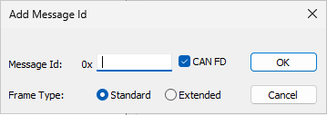

# Message Details

To view the CAN messages configured for a bus, expand the Messages node. With a CAN message selected, the options apply to that message only. Use them to configure the message and to add parameters.

To view the parameters associated with a CAN message, expand the message node. See [Parameter Details](parameter-details.md).

## Message panel

| Option | Description |
|---|---|
| **Message Id** | The unique CAN identifier of the message, in hexadecimal. |
| **Rate** | The time between transmissions of the message, in ms. |
| **Description** | A short description of the CAN message. |
| **Data Frame Type** | **Standard** (11-bit ID) or **Extended** (29-bit ID). |
| **CAN FD** | Select to make the message a CAN FD frame. Only available when the bus supports CAN FD. |
| **Message Length** | The length of the CAN message in bytes: 0 to 8 for classic CAN, or up to 64 for CAN FD. For CAN FD messages only the valid CAN FD lengths can be selected (0 to 8, 12, 16, 20, 24, 32, 48 and 64). For multiplexed messages, the length must be the same for all multiplexer values. The box next to the length shows the buffer to which the message is assigned. |
| **Parameter Count** | The number of parameters associated with the message. The box next to it shows the mode of the message (TRANSMIT, RECEIVE or NOT CONFIGURED), which is the same for all the messages in a buffer (see [Buffers](buffers.md)). |
| **New Parameter** | Opens the Add Parameter dialog box. See [CAN Parameters](../can-parameters.md). |
| **Layout** | Opens the CAN Message Parameter Layout dialog box (see below). |

If you shorten a message, the start bits of any parameters that no longer fit are adjusted and you are asked to check the parameter settings.

## Multiplexed panel

Multiplexed CAN messages allow more measurement parameters to be received by a CAN buffer than can be packed into a single CAN message.

- **Multiplexed** - Select this check box to multiplex some or all of the message data.
- **Byte Order** - The byte order of the multiplexer, **MSB First** or **MSB Last**. See [CAN Bit Definitions](../can-bit-definitions.md).
- **Start Bit** - The position in the message data where the multiplexer value starts. See [CAN Bit Definitions](../can-bit-definitions.md).
- **Bit Length** - The length, in bits, of the multiplexer value. The maximum is 16.
- **Multiplexer Values** - When this message is transmitted, multiplexed messages with values from 0 to Multiplexer Values - 1 are sent.

## CAN Message Parameter Layout

Click **Layout** to display a grid of the bytes and bits of the message, showing where each parameter is placed. The grid has 8 byte rows for a classic CAN message and 64 byte rows for a CAN FD message. For a multiplexed message, select the **Multiplex Id** to display. Any layout warning is shown above the grid.
