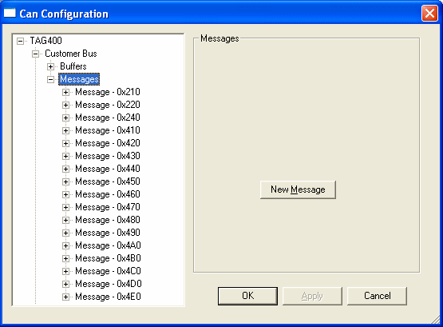

# CAN Messages

With the Messages node selected, the **New Message** button is displayed so that new CAN messages can be added to the configuration.

To add a CAN message, click **New Message** (or right-click the Messages node and select **Add CAN Message**). In the **Add Message Id** dialog box enter the **Message Id** (hexadecimal), select **CAN FD** if the message is a CAN FD frame (only available on CAN FD buses), select the **Frame Type** (**Standard** or **Extended**) and click **OK**. The new message is added to the list.

Right-click the Messages node for the following commands:

- **Import Messages...** - Replace the message configuration with one imported from a file.
- **Merge Messages...** - Merge messages from a file into the existing configuration.
- **Export Messages...** - Export the message configuration to a .csv file.

See [Import/Export Buffers and Messages](../import-export-buffers-and-messages.md).

To view the CAN messages configured for the bus, expand the Messages node. Messages are listed as, for example, *Message - 0x210*, *Message Ext - 0x...* for extended frames and *Message FD - 0x...* for CAN FD frames. To configure a message, select it in the list; the options apply only to that message.

**See also:** [Message Details](message-details.md)
