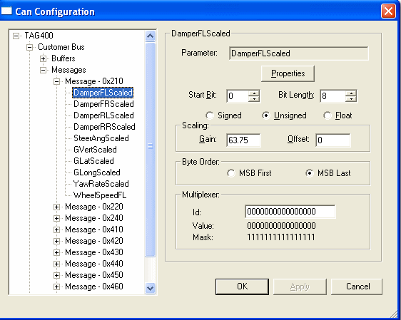

# Parameter Details

To view the parameters associated with a CAN message, expand the message node. With a parameter selected, the options apply to that parameter only.

## Parameter panel

- **Parameter** - The name of the parameter. For received parameters, this is the name displayed by System Monitor and ATLAS. For transmitted parameters, this is the name of the parameter to be transmitted; click **...** to choose one from a list.
- **Properties** - Opens the Parameter Properties dialog box to edit the [Parameter Properties](../../../../using-system-monitor/parameters/parameter-properties/index.md).
- **Start Bit** - The position in the message data where the parameter starts: 0 to 63 for a classic CAN message, or 0 to 511 for a CAN FD message. See [CAN Bit Definitions](../can-bit-definitions.md).

    !!! note
        When MSB Last is selected as the byte order, the Start Bit shows the normalised value. For a parameter at the start of a CAN message the Start Bit is shown as 0, although its underlying value is 7. See [CAN Bit Definitions](../can-bit-definitions.md).

- **Bit Length** - The length of the parameter in bits. The maximum is 32.
- **Signed** / **Unsigned** / **Float** - Whether the parameter is signed, unsigned or floating point. If Float is selected, the Bit Length must be 32.

## Scaling panel

- **Gain** - The gain for converting a scaled value into a raw value.
- **Offset** - The offset for converting a scaled value into a raw value.

The scaling is applied as follows:

Raw Value = GAIN × Scaled Value + OFFSET

## Byte Order panel

Select the byte order of the parameter: **MSB First** or **MSB Last**.

## Multiplexer panel

**Id** - If the message is multiplexed (see [Message Details](message-details.md)), the multiplexer ID defines which multiplexed messages the parameter is in.

A parameter can be in more than one multiplexed message, because the multiplexer ID is a combined value and mask:

- 0, 1 or X can be used for each bit of the multiplexer ID, where X means that the bit does not matter.
- For example, if a parameter is in all the messages with an even multiplexer value, set the multiplexer ID to XXXXXXXXXX0.

**Value** - Calculated from the multiplexer ID. The parameter is transmitted or received if the value equals the multiplexer value of the message being processed, after any bits in the mask are ignored.

**Mask** - Calculated from the multiplexer ID. Defines which bits of the multiplexer value are ignored when deciding whether to include the parameter in the message.
