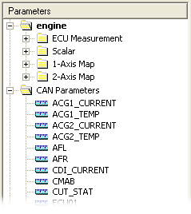
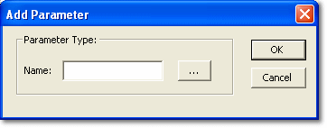

# CAN Parameters

When a CAN Configuration file is added to the project, a CAN Parameters folder is added to the System Monitor Explorer.

This folder contains the CAN parameters configured in the ECU, which can be associated with CAN **Receive** messages.

!!! note
    Parameters associated with **Transmit** CAN messages are not listed in the CAN Parameters folder. For a parameter to be associated with a CAN Transmit message, it must exist in the ECU Measurement Parameters folder.

## Add a CAN parameter

To associate a new parameter with a CAN message, select the message and click **New Parameter** (or right-click the message and select **Add CAN Parameter**) to open the Add Parameter dialog box.

- **Name** - Enter the name of the parameter to associate with the selected CAN message. For a Transmit message, the parameter must be listed in the ECU Measurement Parameters folder of the System Monitor Explorer. Click **...** to browse for a parameter in the [Select Parameter](../../../using-system-monitor/parameters/selecting-parameters/selecting-a-single-parameter.md) dialog box.
- **OK** - Associate the parameter with the selected CAN message.

**See also:** [Parameter Details](can-configuration-dialog-box/parameter-details.md)
