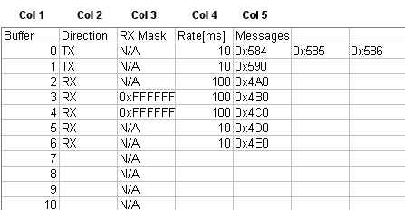
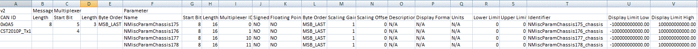
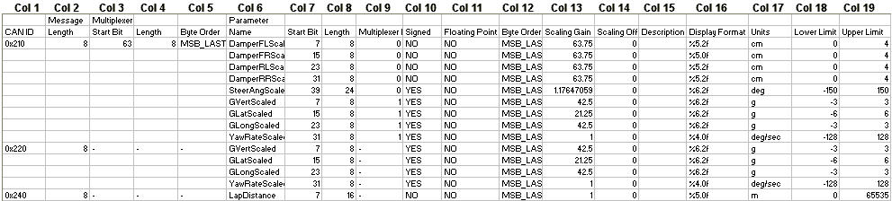

# Import/Export Buffers and Messages

Buffer and message configurations can be imported into the CAN configuration from .csv files, and exported from it as .csv files.

!!! note
    When you import a buffer or message configuration file, all the existing buffer or message configurations are overwritten by the imported file. To add messages from a file without replacing the existing ones, use **Merge Messages...**.

Import or export a buffer configuration:

1. Select **Logging** > **CAN Configuration...** to open the CAN Configuration dialog box.
2. Expand the CAN bus and select **Buffers**.
3. Right-click and select **Import Buffers...** or **Export Buffers...**.

Import, merge or export a message configuration:

1. Select **Logging** > **CAN Configuration...** to open the CAN Configuration dialog box.
2. Expand the CAN bus and select **Messages**.
3. Right-click and select **Import Messages...**, **Merge Messages...** or **Export Messages...**.

The complete CAN configuration can also be imported or exported in DBC format; right-click the unit node and select **Import CAN DBC Configuration...** or **Export CAN DBC Configuration...** (see [CAN Configuration Dialog Box](can-configuration-dialog-box/index.md)).

## CSV file formats

Buffer and CAN message CSV import files must be formatted as described below.

### Buffer CSV file format

The header row is: Buffer,Direction,RX Mask,Rate[ms],Messages

| Col | Name | Description |
|---|---|---|
| 1 | Buffer | The number of the buffer on the CAN bus. |
| 2 | Direction | The mode of the CAN messages configured for the buffer: TX = Transmit, RX = Receive, blank = not configured. |
| 3 | RX Mask | The Receive Mask value, if one is configured for the buffer. Blank = not configured. |
| 4 | Rate[ms] | The time, in ms, between each CAN message being transmitted. |
| 5 | Messages | The IDs of the CAN messages configured for the buffer. If there is more than one, they must be comma separated. |

Sample buffer file:

### CAN message CSV file format

Following a change in the representation of the parameter start bit, v2 of the CAN message CSV format is used. For parameters set as MSB Last, the start bit is written as the logical bit position.

v2 files are identified by the text v2 as the first value of the first header row. All exported files use the v2 format; both formats can be imported.

| Col | Name | Description |
|---|---|---|
| 1 | CAN ID | The CAN message ID: 0 to 0x7FF for 11-bit IDs, 0 to 0x1FFFFFFF for 29-bit IDs. The suffix **x** marks an extended (29-bit) frame and **fd** a CAN FD message (for example 0x1A3fd, or 0x1A3fdx for an extended CAN FD message). |
| 2 | Length | The CAN message length in bytes (up to 8, or up to 64 for CAN FD). |
| 3 | Start Bit | Multiplexed messages: the position in the message data where the multiplexer value starts. |
| 4 | Length | Multiplexed messages: the length, in bits, of the multiplexer value. The maximum is 16. |
| 5 | Byte Order | Multiplexed messages: the byte order of the multiplexer, MSB First or MSB Last. If the message is not multiplexed, columns 3, 4 and 5 are -. |
| 6 | Name | The name of the parameter associated with the CAN message. If there is more than one, each further parameter is listed on a new line. |
| 7 | Start Bit | The position in the message data where the parameter starts. |
| 8 | Length | The length of the parameter in bits. The maximum is 32. |
| 9 | Multiplexer ID | Defines which multiplexed messages the parameter is in. See [Parameter Details](can-configuration-dialog-box/parameter-details.md). |
| 10 | Signed | Whether the parameter is signed: YES or NO. For floating point parameters this must be NO. |
| 11 | Floating Point | Whether the parameter is floating point. |
| 12 | Byte Order | The byte order of the parameter: MSB First or MSB Last. |
| 13 | Scaling Gain | The gain for converting a scaled value into a raw value. |
| 14 | Scaling Offset | The offset for converting a scaled value into a raw value. |
| 15 | Description | The parameter description. |
| 16 | Display Format | The display format. |
| 17 | Units | The display units. |
| 18 | Lower Limit | The lower value limit. |
| 19 | Upper Limit | The upper value limit. |
| 20 | Identifier | The unique identifier of the CAN parameter. |
| 21 | Display Limit Low | The lower display limit. |
| 22 | Display Limit High | The upper display limit. |

Sample v2 message file:

Sample v1 message file:

