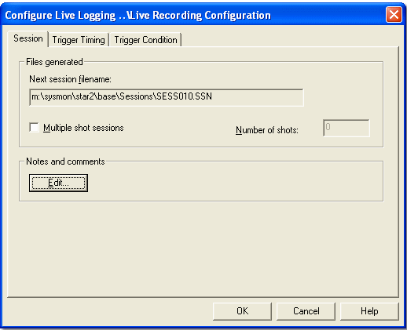

# Live Logging - Session tab

Use the Session tab of the Configure Live Logging dialog box to set where the Session file recorded by System Monitor is created, how it is named, and the Session details.

## Files generated panel

**Session Location** - The folder in which Session files (.ssn) are created. By default this is the \Sessions\ folder that is created for the project (see [Creating a Project](../../../project-management/projects/creating-a-project/stage-1-define-project.md)). Click **...** to select a different folder.

**Incrementing Session Filename** - Select how each Session file is named:

- **Name** - Enter a file name in the text box. The .ssn extension is added if you do not type it. If a file of that name already exists, the number in the file name is incremented so that each recorded Session has a unique file name.
- **Date/Time** - The file name is generated from the date and time at which recording starts, in the form *yymmddhhmmss*.ssn. The text box is not used.

**Multiple shot sessions** - When selected, the number of sessions entered in the **Number of shots** text box (maximum 999) is recorded. Each session is recorded automatically when the trigger conditions are met, and each has its own Session file.

When the **Multiple shot sessions** check box is cleared, only one session is recorded when the trigger conditions are met.

If triggering is set to Manual on the [Trigger Timing tab](trigger-timing-tab.md), Multiple shot sessions has no effect.

## Notes and comments panel

**Edit...** - Opens the [Session Details](../session-details.md) dialog box where the Session details can be edited.

**See also:** [Live Logging](index.md); [Session Details](../session-details.md)
