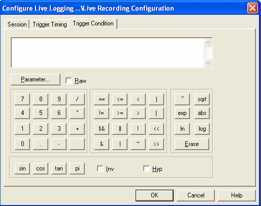

# Live Logging - Trigger Condition tab

Use the Trigger Condition tab of the Configure Live Logging dialog box to define the condition that acts as a trigger for the recording of the Session.

A session is recorded according to the settings in the [Trigger Timing tab](trigger-timing-tab.md). The trigger condition is a logical formula created from one or more Measurement Parameters combined by Mathematical Operators.

See [Mathematical Operators](../../../using-system-monitor/parameters/parameter-properties/mathematical-operators.md) for help on creating the formula.

**See also:** [Measurement Parameters](../../../using-system-monitor/parameters/measurement-parameters.md)
