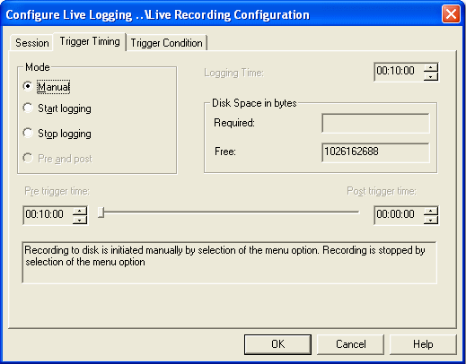

# Live Logging - Trigger Timing tab

Use the Trigger Timing tab of the Configure Live Logging dialog box to set the length of the Session and how the trigger is used.

## Logging Time

The Logging Time is the length of the session, in hours:minutes:seconds. The default is ten minutes (00:10:00).

## Mode panel

Select how the trigger is used:

- **Manual** - The trigger is not used. Recording is started and stopped with **Logging** > **Recording**. See [Live Logging - Recording](recording.md).
- **Start logging** - Recording starts when the Trigger Condition is TRUE and stops when the Logging Time has elapsed. Recording restarts if Multiple shot sessions is selected on the [Session tab](session-tab.md).
- **Stop logging** - Recording is started manually with **Logging** > **Recording**, and stops when the Trigger Condition is TRUE or when the Logging Time has elapsed.

A description of the selected mode is shown below the panels.

## Disk Space in bytes panel

The following read-only information is displayed:

- **Required** - The disk space needed to store the session, calculated from the Logging Time, the parameters logged and their logging intervals.
- **Free** - The disk space available in the location where the session is to be stored.

If disk space becomes low while a session is being recorded, System Monitor warns you. If it becomes critically low, the session is closed.

To record more than one session automatically, see [Live Logging - Session tab](session-tab.md).
