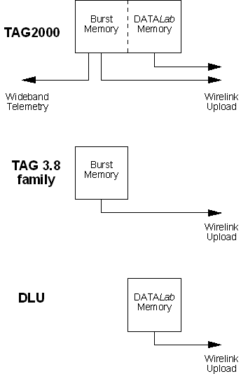

# Logging Memory Allocation

In TAGtronic systems, data logging memory and its associated logging configuration may be one or both of the following types:

| Memory | Description |
|---|---|
| **Burst Memory** | Typically used for engine parameters that need to be acquired at a high data rate. Burst memory is configured by the [Burst Logging](burst-logging/index.md) configuration. Triggering is simple and data is collected at the highest rate that the hardware allows. |
| **DATALab Memory** | Typically used for chassis parameters that can be acquired at a lower data rate. DATALab memory is configured by the [Remote Logging](remote-logging/index.md) configuration. Triggering is more versatile and the sampling rate can be configured. |

For example, the TAG-300 (engine control unit) and MCU-300 (chassis control unit) are distributed control units, each of which has logging memory that can be configured in this way.

System Monitor recognises the type of unit from its [Program Version](../../project-management/program-and-data-versions/index.md) and only allows access to the configuration tools that the unit supports. The configuration tools also apply any restrictions that the hardware imposes, such as the memory size, the number of channels and the maximum number of parameters.

**See also:** [Burst Logging](burst-logging/index.md); [Remote Logging](remote-logging/index.md)
