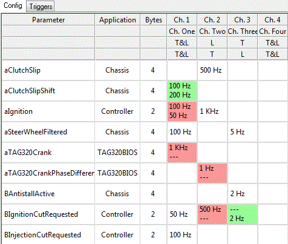
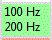
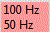
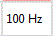
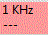
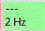
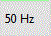

# Remote Configuration Compare - Config Tab

The Config tab shows the parameter logging rates of the two configurations. A colour scheme highlights any differing rates.

The grid has the following columns:

| Column | Description |
|---|---|
| **Parameter** | The parameter name. |
| **Description** | The parameter description. |
| **Application** | The Application associated with the parameter. |
| **Bytes** | The size of the parameter in bytes. |
| **Prime** | An asterisk indicates a Prime Parameter, as defined in the ASAP file. Prime Parameters are logged continually in Channel 1 and cannot be disabled in that channel. |
| **Channels** | The sampling frequency of the parameter in each channel. |

The Parameter, Description, Application, Bytes and Prime columns can be shown or hidden from the context menu.

The column headers show the channel title and channel type in each configuration.

The cell colours show the following:

| Colour | Meaning |
|---|---|
|  | Logging rate in the secondary configuration is higher than in the master. |
|  | Logging rate in the secondary configuration is lower than in the master. |
|  | Logging rate in the secondary configuration is the same as in the master. |
|  | Logging rate exists in the master only. |
|  | Logging rate exists in the secondary only. |
|  | Logging rate merged from the secondary into the master. |

## Merging

To merge values from the secondary configuration, select the cells, right-click and select the merge command. Merge commands are only available if the selected values differ. If some of the selected items are already merged, an undo command is available.

- **Cell merge** - Select one or more cells in the grid, right-click and select **Merge into Master** (or **Undo Merge**). The logging rates of the selected cells are set to those of the secondary configuration.
- **Channel merge** - Right-click a channel column header and select **Merge Channel into Master** (or **Undo Channel Merge**). The logging rates of all the parameters in the channel are set to those of the secondary configuration.
- **Channel title merge** - Right-click in the first two header rows and select **Merge Channel title into Master** (or **Undo Channel title merge**). The master channel title is set to that of the secondary.
- **Channel type merge** - Right-click in the lower two header rows and select **Merge Channel type into Master** (or **Undo channel type merge**). The master channel type is set to that of the secondary.

Merges are applied to the project configuration when you click **Commit** (see [Remote Configuration Compare](index.md)).
