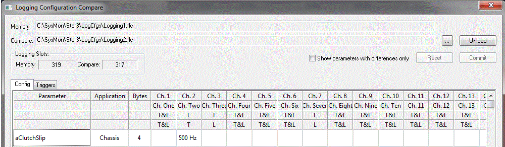

# Remote Configuration Compare

Remote Configuration Compare lets you compare the project [remote logging configuration](../remote-logging/index.md) with another remote logging configuration file (.rlc), and merge details from that file into the project configuration.

## Logging Configuration Compare dialog box

To open the Logging Configuration Compare dialog box, select **Logging** > **Remote Configuration Compare** (CTRL+F6).

When the dialog box opens, the project remote logging configuration is shown in the **Memory** box. To compare it with another configuration, click **...** next to the **Compare** box and select the file. Both configurations are then displayed for comparison and merging.

| Control | Description |
|---|---|
| **...** | Loads a configuration to compare and merge. |
| **Unload** | Unloads the compare configuration. |
| **Logging Slots** | Shows the logging slots used by the project configuration (**Memory**) and, if one is loaded, by the compare configuration (**Compare**). |
| **Show parameters with differences only** | When selected, only the differences between the configurations are displayed. |
| **Filter** | Opens a parameter selection dialog box listing the parameters of both configurations. Only the parameters you select are shown. |
| **Invert Filter** | When selected, the filter is reversed. |
| **Reset** | Undoes any outstanding merges. Once committed, a merge cannot be undone. |
| **Commit** | Commits the outstanding merges into the project remote logging configuration. |
| **Close** | Closes the dialog box. |

The comparison is shown on two tabs:

- [Config](config-tab.md) - The parameter logging rates in each channel.
- [Triggers](triggers-tab.md) - The channel triggers.

The dialog box is resizable, and its size is remembered.

**See also:** [Remote Logging](../remote-logging/index.md)
