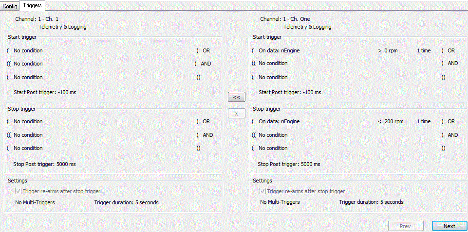

# Remote Configuration Compare - Triggers Tab

The Triggers tab shows the start and stop triggers and trigger settings of a channel in the two configurations side by side, so that differences can be seen.

- **<<** - Merges the secondary trigger into the master. Only available if the triggers differ.
- **X** - Undoes the merge of the trigger. Only available if the trigger has been merged.
- **Next** - Shows the trigger of the next channel.
- **Prev** - Shows the trigger of the previous channel.

Merges are applied to the project configuration when you click **Commit** (see [Remote Configuration Compare](index.md)).

**See also:** [Remote Logging - Channel Trigger](../remote-logging/channel-trigger.md)
