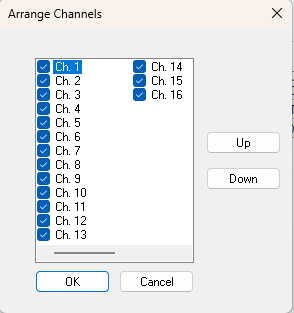

# Arrange Channels

The Arrange Channels dialog box controls which channels are shown in the Configure Remote Logging dialog box, and the order in which they are displayed. To open it, click **Arrange...** on the Channel Overview tab, or right-click a channel column header and select **Arrange**.

- To hide a channel, clear the check box next to the channel name and click **OK**. The channel column is removed from the Configure Remote Logging dialog box.
- To change the order in which channels are displayed, select a channel and click **Up** or **Down** to move it in the list. Click **OK**. The channel columns are rearranged in the Configure Remote Logging dialog box.

**See also:** [Channel Properties and Configuration](configure-remote-logging-dialog-box/channel-properties-and-configuration.md)
