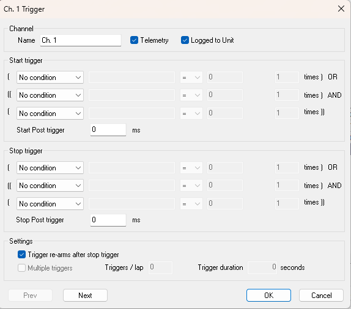

# Remote Logging - Channel Trigger

Use the Channel Trigger dialog box to define the start and stop triggers for a channel. To open the dialog box, click **Set Trigger** on the Channel Overview tab of the Configure Remote Logging dialog box, or right-click a channel column header and select **Set Trigger**.

## Channel panel

- **Name** - The name of the channel.
- **Telemetry** - Select to send the channel by telemetry.
- **Logged to Unit** - Select to log the channel in the unit memory.

Use **Prev** and **Next** to move to the triggers of the previous or next channel.

## Start trigger and Stop trigger panels

The Start and Stop triggers both have the same format, consisting of three conditions with the following relationship:

Condition 1 OR (Condition 2 AND Condition 3)

### Condition options

Each condition is defined by a row. The left-hand drop-down list has the following condition options:

- **On data** - The **Set Trigger Parameter** dialog box opens so that you can select a parameter (see [Selecting a Single Parameter](../../../using-system-monitor/parameters/selecting-parameters/selecting-a-single-parameter.md)). Only parameters that are included in the current Remote Logging Configuration are available. Selecting On data enables the other fields in the row (see On data settings below).
- **Ignition on** - The condition is TRUE when the engine ignition is switched on.
- **Lap trigger** - The condition is TRUE when the ECU receives a signal from the Lap Trigger.
- **External Trigger** - The condition is TRUE when the unit receives an external trigger input.
- **No condition** - Fixed at FALSE for Condition 1 and TRUE for Conditions 2 and 3. This ensures that selecting No condition does not override the other conditions.

### On data settings

When **On data** is selected as a condition, all the fields in the row are enabled:

- **Name** - The name of the selected parameter.
- **Comparison operator** - Select the operator from the drop-down list:

    | Operator | The condition is TRUE when the parameter value is |
    |---|---|
    | **=** | equal to the test value |
    | **<** | less than the test value |
    | **>** | greater than the test value |
    | **!=** | not equal to the test value |
    | **>=** | greater than or equal to the test value |
    | **<=** | less than or equal to the test value |

- **Test value** - Enter the test value. It must be within the valid range of the parameter. Parameter units are shown next to this field where appropriate.

**Times** - Enter the number of times the condition must occur before it is considered to be TRUE. The default is 1. This field is available for all condition types except No condition.

### Start / Stop Post trigger

The effect of the trigger is delayed by the time, in milliseconds, set in the **Start Post trigger** and **Stop Post trigger** boxes. The default is 0.

- **Start Post trigger** - From -999999 to 999999 ms. A negative value gives a pre-trigger period, so data from before the start trigger is included.
- **Stop Post trigger** - From 0 to 999999 ms.

## Settings panel

- **Trigger re-arms after stop trigger** - When selected, a set of data is logged every time the trigger conditions are met. When cleared, only one set of data is logged.
- **Multiple triggers** - Used only to calculate the Duration shown on the Channel Overview tab; it does not affect the logging configuration. When selected, the **Triggers / lap** and **Trigger duration** settings are used to estimate the time required to log the data. When cleared, the duration is calculated assuming that the parameters are logged continuously.
- **Triggers / lap** - An estimate of the number of times the trigger will be activated in each lap.
- **Trigger duration** - An estimate of the average length of time, in seconds, that data is logged each time the trigger is activated.

**See also:** [Remote Logging - Channel Overview tab](configure-remote-logging-dialog-box/channel-overview-tab.md); [Remote Logging - Duration](duration.md)
