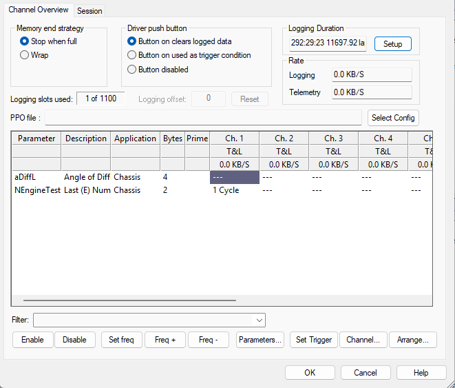

# Remote Logging - Channel Overview tab

Use the Channel Overview tab of the Configure Remote Logging dialog box to define the characteristics of the channels used to store data in the ECU.

The tab has the following areas:

- [Memory end strategy panel](memory-end-strategy-panel.md) - What happens when the logging memory is full.
- [Driver push button panel](driver-push-button-panel.md) - How the driver push button is used.
- [Logging duration and rate](logging-duration-and-rate.md) - The estimated logging duration and the logging and telemetry data rates.
- [Channel Properties and Configuration](channel-properties-and-configuration.md) - The parameter grid, the logging slots and offset, and the control buttons used to configure the channels.

**See also:** [Remote Logging](../index.md)
