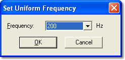

# Channel Properties and Configuration

The Remote Logging Configuration is for use with the [DATALab](../../logging-memory-allocation.md) data logging system. The logging memory is divided into channels, which can be configured independently. The number of channels depends on the unit.

To add parameters to the configuration, click **Parameters...** to open the [Select Parameters](../../../../using-system-monitor/parameters/selecting-parameters/selecting-multiple-parameters.md) dialog box. The maximum number of parameters (logging slots) depends on the unit. **Logging slots used** shows the number of slots used and the number available, for example 120 of 512.

Each parameter is available in all the channels. When a parameter is added, it is disabled by default. To log the parameter you must set a sampling frequency.

You can log the same parameter at different frequencies in different channels. The parameter can then be sampled at different frequencies under different circumstances, as each channel can have a different [Trigger](../channel-trigger.md). In ATLAS, parameter data from different channels can be combined to give the best available resolution.

## Parameter grid

The grid has the following columns:

| Column | Description |
|---|---|
| **Parameter** | The parameter name. |
| **Description** | The parameter description. |
| **Application** | The Application associated with the parameter. |
| **Bytes** | The size of the parameter in bytes. |
| **Prime** | An asterisk indicates a Prime Parameter, as defined in the ASAP file. Prime Parameters are logged continually in Channel 1 and cannot be disabled in that channel. |
| **Channels** | One column for each channel, showing the sampling frequency for the parameter in that channel. --- indicates that logging is disabled for the parameter in that channel. |

The Parameter, Description and Application columns can be shown or hidden using the context menu.

!!! note
    If a cell background is red, the selected frequency is higher than the maximum refresh rate of the parameter (see the [Parameter Properties Measurement tab](../../../../using-system-monitor/parameters/parameter-properties/measurement-tab.md)).

Use the **Filter** box below the grid to filter the parameter list (see [Parameter Filter](../../../../using-system-monitor/parameters/selecting-parameters/parameter-filter.md)).

## Context menu commands

With one or more cells selected, the following context menu commands are available:

- **Frequency** - Use the sub-menu to select a logging frequency for the selected cells. The frequencies offered depend on the unit.
- **Cycle** - Log the selected parameter once per engine cycle. The cells display: 1 Cycle. Only available if the unit supports it.
- **Engine Segment** - Opens the [Synchro Pattern](../synchro-pattern.md) dialog box. Use this to select the engine segments in which to log the selected parameter. The cells display: &lt;Seg&gt;. Only available if the unit supports it.
- **Edge** - Log the parameter on each signal edge. Only shown for parameters that support logging on edge.
- **Prime** - Set the minimum logging required for a Prime Parameter.

Right-click a channel column header for the following commands: **Set Trigger**, **Arrange**, **Channel**, **Logging** and **Telemetry**. **Logging** and **Telemetry** select whether the channel is logged to the unit and whether it is sent by telemetry.

## Controls

The control buttons apply to the cell or cells selected in the grid. With multiple cells selected, a command can be applied to a:

- **Row** - For example, enable a parameter in all channels.
- **Column** - For example, set the same frequency for all parameters in a channel.
- **Block** - For example, enable parameters in a subset of channels.

Select multiple cells by clicking and dragging with the mouse or by using the keyboard arrow keys. To select all channels for a parameter, click the name in the Parameter column.

| Control | Description |
|---|---|
| **Enable** | The selected parameters are enabled in the selected channels. If a frequency was previously set, it is reinstated. Otherwise the frequency is set to 100 Hz. |
| **Disable** | The selected parameters are disabled in the selected channels. The DELETE key has the same effect. |
| **Set freq** | Opens the Set Uniform Frequency dialog box (see below). |
| **Freq +** / **Freq -** | Increase or decrease the frequency of the selected parameters in the selected channels to the next valid frequency. If the parameter is disabled in that channel, the previous value is recalled and increased or decreased. If no value was set, 100 Hz is assumed. Keyboard equivalents: plus and minus keys. |
| **Parameters...** | Opens the Select Parameters dialog box to add or remove parameters. |
| **Set Trigger** | Opens the [Channel Trigger](../channel-trigger.md) dialog box where the start and stop triggers for the selected channel are defined. |
| **Channel...** | Opens the Channel dialog box for the selected channel. Use it to edit the channel **Name** and to select whether the channel is used for **Telemetry**, **Logged to Unit**, or both. |
| **Arrange...** | Opens the [Arrange Channels](../arrange-channels.md) dialog box. Use it to select which channels are shown and to change the order of the channels in the grid. |

### Set Uniform Frequency

Select a value from the **Frequency** drop-down list. The frequencies offered depend on the unit; on units that support it, 1 Cycle and &lt;Seg&gt; (engine segment) are also offered. To select a frequency with the keyboard, use the up and down cursor keys, or type the first digit of the frequency.

When you click **OK**, the selected parameters in the selected channels are set to the selected frequency, including those that were disabled.

## Logging offset

**Logging offset** is only available if the unit defines a default logging offset. Click **Reset** to return the offset to the unit default; you are asked to confirm the change.

## Including other configurations

**PPO file** shows the Prime Parameter Override (.ppo) file used by the project.

Click **Select Config** to open the Select Active Logging Configurations dialog box. The current configuration is always the first entry. Use **Add** and **Delete** to add or remove up to seven further remote logging configuration files, and select the check boxes of the configurations to include. The included configurations are merged into the configuration that is downloaded to the unit.

**See also:** [Remote Logging - Channel Overview tab](channel-overview-tab.md); [Remote Logging - Channel Trigger](../channel-trigger.md)
