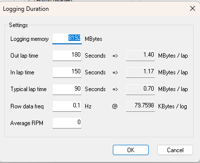

# Remote Logging - Duration

System Monitor calculates the Duration of the Remote Logging session and displays it in the Logging Duration panel of the Channel Overview tab. The calculation is based on the sample rates of all the enabled parameters in all channels and on the information set in the Logging Duration dialog box.

To open the Logging Duration dialog box, click **Setup** on the Channel Overview tab of the Configure Remote Logging dialog box.

!!! note
    These settings are only used to calculate the Logging Duration display. They do not affect the logging configuration.

| Setting | Description |
|---|---|
| **Logging memory** | The size of the memory available for logging, in MBytes. |
| **Out lap time** | The estimated duration of the out lap, in seconds. One out lap is included in the Duration display. |
| **In lap time** | The estimated duration of the in lap, in seconds. One in lap is included in the Duration display. |
| **Typical lap time** | The estimated typical duration of a flying lap, in seconds. This value is used to calculate the number of laps shown in the Duration display. |
| **Row data freq** | The average sample rate, in Hz, of [Row data](../channels.md). The right-hand value shows the memory needed to log the row data. This value is subtracted from the memory available for configured logging. |
| **Average RPM** | The estimated average engine speed. |

For the lap times, the value on the right shows the memory needed to log data for that lap (MBytes / lap).

The Duration calculation can allow for channels in which sampling is not continuous. See the **Multiple triggers** setting in [Remote Logging - Channel Trigger](channel-trigger.md).

**See also:** [Remote Logging - Channel Overview tab](configure-remote-logging-dialog-box/channel-overview-tab.md); [Remote Logging - Channel Trigger](channel-trigger.md)
