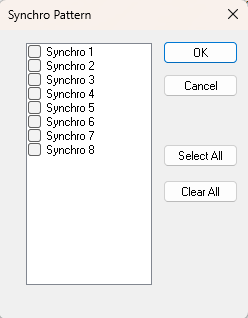

# Synchro Pattern

The Synchro Pattern dialog box determines the engine segments in which a parameter is logged.

To open the Synchro Pattern dialog box, select one or more cells in the parameter grid of the Configure Remote Logging dialog box, right-click and select **Engine Segment**. This command is only available if the unit supports it.

The selection applies to the selected cells. Select the check boxes of the segments in which to log. Click **Select All** to select every segment or **Clear All** to clear them all. The cells display &lt;Seg&gt;.

**See also:** [Channel Properties and Configuration](configure-remote-logging-dialog-box/channel-properties-and-configuration.md)
