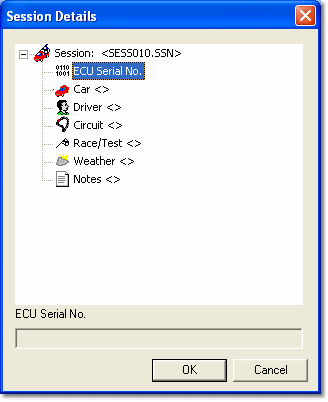

# Session Details

Session Details identify the Session and include information to assist in the analysis of the session data. Session details are used by Live Logging, Remote Logging and Burst Logging.

To open the Session Details dialog box, click **Edit...** in the Notes and comments panel of the [Live Logging - Session tab](live-logging/session-tab.md). The same details are shown on the Session tab of the Configure Remote Logging and [Configure Burst Logging](burst-logging/burst-logging-session-tab.md) dialog boxes.

The following Session Details are read only:

| Detail | Description |
|---|---|
| **Session** | The name of the Session file. For Live Logging this is set by the [Session tab](live-logging/session-tab.md) settings. For Remote and Burst logging the file name is generated by [ATLAS](../../technical-support/atlas.md). |
| **Serial Number** | Taken from the ECU hardware. |
| **Session Start** | Taken from the clock of the system creating the Session file. |
| **Session End** | Taken from the clock of the system creating the Session file. |

The following Session Details can be edited:

- **Car**
- **Driver**
- **Circuit**
- **Race/Test**
- **Weather**
- **Notes**

Edit Session details:

1. Select an editable item with the mouse or keyboard.
2. Click in the text box at the bottom of the dialog box, or press TAB, and enter the text.
3. To accept the text, press ENTER or TAB, or select another item with the mouse.

Session details are shown in [ATLAS](../../technical-support/atlas.md) to help you to identify the Session.

!!! note
    On units whose BIOS configures telemetry, the Session tab is not shown in the Remote and Burst logging dialog boxes; the session details are configured in the Data Version instead.
