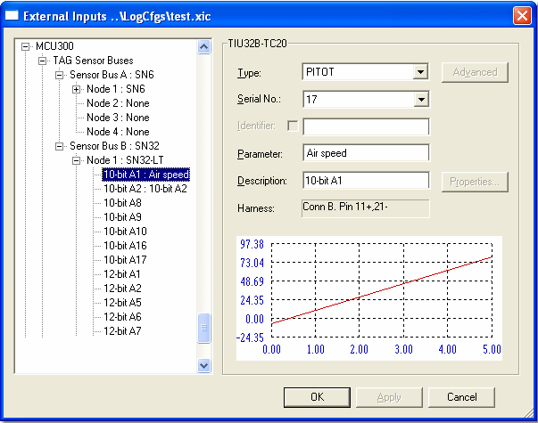

# External Inputs - Adding a Sensor

After you have selected a node, sensors can be added to it.

The tree shows the configuration of sensor inputs to the unit (see [External Inputs - Input Source](external-inputs-input-source.md)).

Add a sensor to the system:

1. Expand the node where you want to add the sensor. To connect directly to the unit, expand **Unit Sensors**.
2. Select the sensor location by clicking it. If you are configuring an SN-6, see [External Inputs - SN-6 Interface Cards](external-inputs-sn-6-interface-cards.md).
3. Select the **Type** of sensor from the drop-down list. The list is taken from the sensor configuration files (see [ECU Files](../../../project-management/files/types-of-files/ecu-files.md)). Some locations are only suitable for particular types of sensor, and the list only shows the sensors that are suitable for the location. The **Harness** box shows the pin and socket to which the sensor must be connected.

    !!! note
        Speed sensors (Hall effect or inductive) require further scaling. For these sensors the **Advanced** button is enabled. Click it to open the [Revs Scaling](external-inputs-speed-sensor-scaling.md) dialog box.

4. Select the serial number of the sensor from the **Serial No.** list. For [Software Calibrated Sensors](../software-calibrated-sensors/index.md), this associates the appropriate calibration data with the sensor, and the calibration data is shown as a graph. For other sensors, select zero. If the sensor type has no calibration data, you must enter a unique serial number. Serial numbers must be unique on the loom.

    !!! note
        A serial number can also be assigned to a sensor by [Sensors & Actuators](../sensors-and-actuators/index.md). This is not linked to the External Inputs Configuration, so you are not prevented from using the serial number more than once.

5. In the **Parameter** box, enter the name to be used for the Measurement Parameter generated by the sensor. The [Identifier](../../../using-system-monitor/parameters/names-descriptions-and-groups.md) is generated from the location of the sensor; to edit it, select the **Identifier** check box and enter the identifier. Identifiers must be unique and must not contain colons.
6. In the **Description** box, enter the description of the Measurement Parameter.
7. Click **Properties...** to open the Parameter Properties dialog box. The Parameter Properties are the same as for a Measurement Parameter, but more attributes can be edited.
8. To add another sensor, click the appropriate location in the tree and repeat from step 3. To select a different node or bus, click it in the tree.
9. When you have finished adding and configuring sensors, click **OK**.

The changes are accepted and a Measurement Parameter is added to the External Inputs parameters group for each newly added sensor (the group is created if it does not already exist).

A message box asks: "Do you want to download the external inputs configuration to the ECU?"

If you select **No**, the configuration is kept in the project and can be saved, or downloaded later using **Sensors** > **External Inputs Download...**.

**See also:** [External Inputs Configuration](external-inputs-configuration.md); [Sensor Bus](../../../hardware/sensor-bus.md); [External Inputs - Speed Sensor Scaling](external-inputs-speed-sensor-scaling.md); [Software Calibrated Sensors](../software-calibrated-sensors/index.md)
