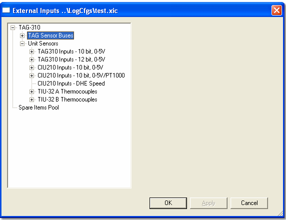

# External Inputs - Input Source

To open the External Inputs dialog box select **Sensors** > **External Inputs Configuration...**.

The left-hand side of the dialog box displays the sensor inputs to the unit. The type of unit is shown at the top, with the input sources listed below it. System Monitor only shows the input sources that are available for the unit.

TAGtronic data loggers and ECUs can accept input from the following sources:

- **TAG Sensor Buses** - The communication link in the DATALab system. See [Sensor Bus](../../../hardware/sensor-bus.md) and [External Inputs - Selecting a Bus](external-inputs-selecting-a-bus.md).
- **Unit Sensors** - Sensors connected directly to the unit. To configure these, see [External Inputs - Adding a Sensor](external-inputs-adding-a-sensor.md).

The tree also contains a **Spare Items Pool** (see [External Inputs - Drag and Drop](external-inputs-drag-and-drop.md)).

!!! note
    CAN links are not configured here. Use **Logging** > **CAN Configuration...** (see [CAN Configuration Dialog Box](../../logging/can-configuration/can-configuration-dialog-box/index.md) and [CAN Link](../../../hardware/can-link.md)).

**See also:** [External Inputs Configuration](external-inputs-configuration.md)
