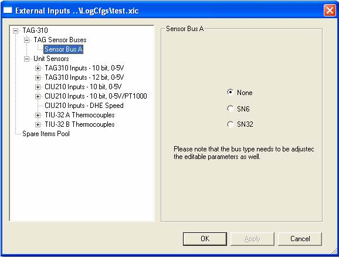

# External Inputs - Selecting a Bus

To open the External Inputs dialog box select **Sensors** > **External Inputs Configuration...**.

The left-hand side of the dialog box displays the configuration of a DATALab system (see [Sensor Bus](../../../hardware/sensor-bus.md)).

Select a bus:

1. Expand the **TAG Sensor Buses** item.
2. Click the bus (A, B, C or D) to configure.
3. Select the type of sensor node on the bus: **None**, **SN6** ([SN-6](../../../hardware/sensor-node-sn-6.md)) or **SN32** ([SN-32](../../../hardware/sensor-node-sn-32.md)).
4. Click **Apply** to accept the configuration.
5. The tree expands so that you can [select a Node](external-inputs-selecting-a-node.md).

!!! note
    The bus type must also be set in the editable parameters of the unit.

**See also:** [External Inputs Configuration](external-inputs-configuration.md)
