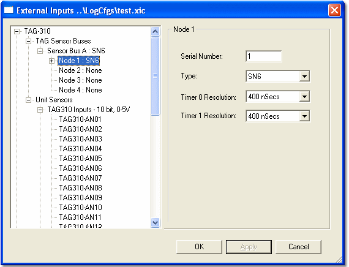

# External Inputs - Selecting a Node

After you have [selected a Bus](external-inputs-selecting-a-bus.md), the tree expands so that a node can be selected.

Select a node:

1. Select the node that you want to configure in the left-hand pane.
2. Enter the address of the node in the **Serial Number** box. The address is set by the hardware and is printed on a label on the case of the sensor node. Each node on a bus must have a unique address.

    !!! warning
        An address of 0 means that the node is not connected and cannot be configured. If you change the address of a configured node to 0, all its settings are lost without warning.

3. Select the type of sensor node from the **Type** drop-down list. There is only one type of SN-6 (SN6). The SN-32 types are SN32, SN32-S and SN32-LT; see [Sensor Node SN-32](../../../hardware/sensor-node-sn-32.md).
4. Click **Apply** to accept the configuration. The node in the tree expands and the timer resolution boxes appear.
5. Select the **Timer 0 Resolution** and **Timer 1 Resolution**. Timer resolution is used for pulsed speed sensors (see [External Inputs - Speed Sensor Scaling](external-inputs-speed-sensor-scaling.md)). The range is from 400 nSecs to 51.2 µSecs, doubling with each step. The default is 400 nSecs.

For sensors connected directly to the unit, select the **Unit Sensors** item to set the **Timer** and its **Resolution**.

The next step is to [add sensors](external-inputs-adding-a-sensor.md).

**See also:** [External Inputs Configuration](external-inputs-configuration.md)
