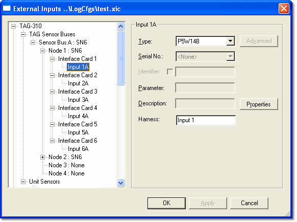

# External Inputs - SN-6 Interface Cards

Sensors on an [SN-6](../../../hardware/sensor-node-sn-6.md) sensor node are connected through interface cards. Each Interface Card item in the tree represents a slot in the SN-6.

Add a sensor to an SN-6 interface card:

1. Expand the node where you want to add the sensor, and then expand the **Interface Card**. The number of the interface card is its slot in the SN-6.
2. Select the first input of the card (for example **Input 1A**) and configure the sensor as described in [External Inputs - Adding a Sensor](external-inputs-adding-a-sensor.md).
3. If required, select the second input (for example **Input 1B**) and configure a second sensor. The second input is not available on interface cards that can only accept one sensor.

An interface card has no software-configurable items. To change the operation of a slot, a different interface card must be fitted.

!!! note
    Each type of interface card can only accept a limited number of sensor types (see [Sensor Bus](../../../hardware/sensor-bus.md)). Ensure that the sensor type you select is compatible with the interface card at that location. Once you have selected a sensor type, System Monitor assumes which type of interface card is fitted at that location and applies the appropriate restrictions (see [Sensor Node SN-6](../../../hardware/sensor-node-sn-6.md)). For example, a 5-wire pressure sensor must be loaded into the first input of the card, and the second input is then used by the same sensor. BRIDGE cards can only be fitted in slots 1 to 4.

**See also:** [External Inputs - Adding a Sensor](external-inputs-adding-a-sensor.md); [Sensor Bus](../../../hardware/sensor-bus.md); [Sensor Node SN-6](../../../hardware/sensor-node-sn-6.md)
