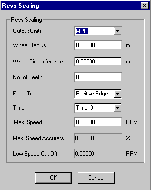

# External Inputs - Speed Sensor Scaling

The Revs Scaling dialog box is opened, for inductive and Hall effect sensor types, by clicking **Advanced** in the External Inputs dialog box when a sensor is being added.

Speed sensors provide a pulse signal when they sense the movement of a piece of ferrous metal. This signal is usually caused by the rotation of a toothed wheel, and the output of the sensor is converted to a road speed or revolution value.

Use the Revs Scaling dialog box to configure the conversion of the sensor output to give the required parameter.

The configuration options are:

**Output Units** - The units that the sensor output is scaled to:

- **MPH** - Road speed in miles per hour. This is the default.
- **KPH** - Road speed in kilometres per hour.
- **RPM** - Engine speed in revolutions per minute.
- **Hz** - Frequency in hertz (cycles per second).
- **µSecs** - Time interval in microseconds.

**Wheel Radius** / **Wheel Circumference** - For MPH and KPH scaling only. Enter the size of the wheel in metres. Entering a value in one box automatically recalculates the other. You must enter a radius or a circumference.

**No. of Teeth** - The number of teeth on the wheel. Automatically set to 1 if the Output Units are Hz and 0 if the units are µSecs. For MPH, KPH or RPM the value must be non-zero.

**Edge Trigger** - The edge of the sensor signal that triggers the timing pulse:

- **Positive Edge** - The trigger detects a rising voltage. This is the default.
- **Negative Edge** - The trigger detects a falling voltage.

**Timer** - Select **Timer 0** or **Timer 1**. The default is Timer 0. The timer resolution is set when you [select a Node](external-inputs-selecting-a-node.md).

**Max. Speed** - A nominal maximum speed (optional).

**Max. Speed Accuracy** / **Low Speed Cut Off** - If a Max. Speed has been entered, System Monitor calculates the Max. Speed Accuracy and Low Speed Cut Off from the timer resolution and the number of teeth. These are read only.

**See also:** [External Inputs - Adding a Sensor](external-inputs-adding-a-sensor.md); [External Inputs - Selecting a Node](external-inputs-selecting-a-node.md)
