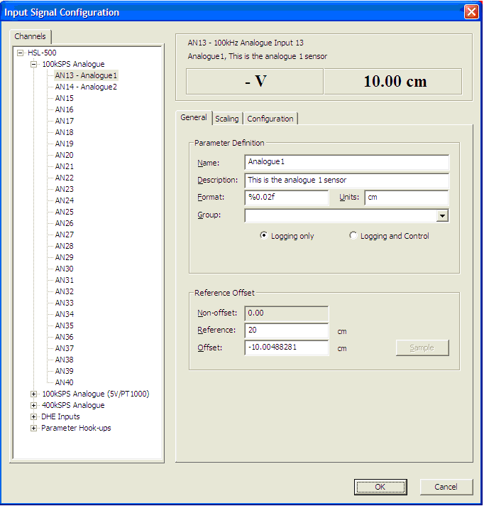

# Input Signal Configuration Tool

To open the Input Signal Configuration dialog box select **Logging** > **Input Signal Configuration...**.

The Input Signal Configuration tool is used to configure analogue and digital input signals on Motion Applied units that support it. It enables you to:

- Manually configure analogue and digital input signals.
- Sample the signal or sensor transfer function.
- Export an input configuration to a file.
- Import an input configuration from a file.
- Recalculate the offset.
- Obtain an overview of how all the inputs are configured.
- Manage the input scaling.
- Manage the hardware and filter configuration.

The dialog box has a **Channels** tree on the left, a signal information area at the top right, and the **General**, **Scaling** and **Configuration** tabs below it, where the configuration of the selected input signal is set up.

Depending on the signal being configured (for example analogue or digital) and the functions supported by the control unit, some options and scaling methods may be unavailable.

The scaling methods offered depend on the unit, and can include:

- Interpolation Table
- Look-up Table
- Gain and Offset
- High and Low Sample Points
- Extrapolation
- Rotational
- Wheel Speed (Metric)
- Wheel Speed (US)

When you click **OK**, all modifications are accepted and written to the Data Version file, which must be downloaded to the unit for the modifications to be applied.

If you have re-sampled one or more signals, the logging configuration file containing these modifications must also be downloaded to the unit. The status of both files (Data Version and remote logging configuration) can be viewed in the ECU Bar display.

In the System Monitor Parameter Explorer, all the scaled measurement parameters are grouped in a top-level group called Input Signals. These parameters also appear in an Input Signals group in the ATLAS logged data.

To sample every input signal on the current page, select **Logging** > **Input Signal Sample Entire Page** (CTRL+ALT+SHIFT+P).

## Context menu

Right-click a group node or an individual input signal in the tree for the following commands:

- **Import Signal** - Imports the signal properties from a CSV file.
- **Export Signal** - Exports the signal properties to a CSV file.
- **Clear Signal** - Clears the signal, resetting all values to 0. You are asked to confirm.

If you right-click a group node (for example AN01-AN12 (400kSPS)), the command is performed for all the signals in that group.
