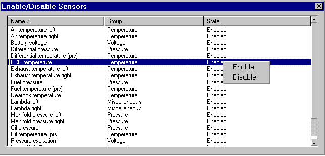

# Enabling and Disabling Sensors and Actuators

The Enable/Disable Sensors dialog box lists all the sensors and actuators that can be enabled and disabled by System Monitor. They are defined by the sensor enable/disable ini file (ENDIS.INI, see [ECU Files](../../../project-management/files/types-of-files/ecu-files.md)) and do not have to be the same as those listed in the sensors ini file.

To open the dialog box select **Sensors** > **Enable / Disable**.

The list has the columns **Name**, **Group** and **State**, and can be sorted by Name or Group. The names and groups (for example Speed, Pressure, Temperature, Current, Voltage and Miscellaneous) are taken from the enable/disable file and are not the same as the names and tabs in the [Sensors & Actuators dialog box](sensors-and-actuators-dialog-box.md).

Enable/Disable Sensors only operates on a connected ECU, and its settings are not saved in the Sensor Set files. The **State** column shows **Enabled** or **Disabled** for each sensor or actuator, or **Unknown - No ECU** if no ECU is connected.

Change the state of a sensor:

1. Select the row for the device by clicking it or by using the UP and DOWN cursor keys. To select multiple rows, use the CTRL or SHIFT keys with the mouse or the Space Bar.
2. Right-click and select **Enable** or **Disable** from the context menu.

A message is sent to the ECU to enable or disable the sensor. When the change has been made, the **State** column changes to confirm the new status.

!!! note
    Pressing ENTER toggles the state of the focused sensor between Enabled and Disabled without using the context menu.

Disabling a sensor makes a change in the ECU memory that prevents the output of the sensor from being used in any way. The logging of a sensor can be switched off without disabling it if required, see [Logging](../../logging/index.md).
