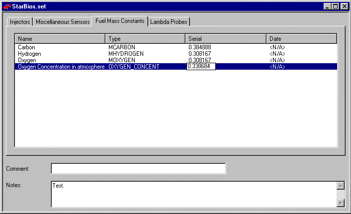

# Sensor and Actuator Constants

Some types of sensor require one or more constant values to be entered to complete their calibration. Constants can be placed on any tab of the Sensors & Actuators dialog box and may be mixed with sensor descriptions. For clarity, constants are usually placed on a separate tab.

Assign a value to a constant:

1. Select the row for the constant.
2. Enter the value. A text box opens automatically, and the Edit context menu becomes available.
3. To accept the value, click another row or press ENTER. To leave the row without changing the value, press ESC.

The data on the Constants tab is part of the [Sensor Set](sensor-sets.md) data. It is sent to, and obtained from, the ECU with the Sensor Set data.

**See also:** [Sensors & Actuators](index.md); [Sensor Sets](sensor-sets.md)
