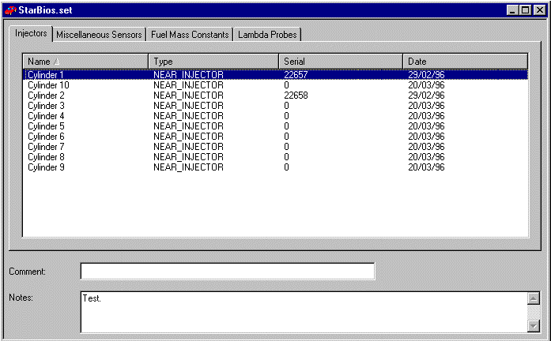

# Sensors & Actuators dialog box

The Sensors & Actuators dialog box is opened by one of the following actions:

- An existing Sensor Set is opened using **File** > **Open** or **Sensors** > **Open Sensor Set**.
- A Sensor Set is uploaded using **Sensors** > **Sensor Set Upload** or **Sensor Set Upload New**.
- A new Sensor Set file is created using **File** > **New**.

The Sensors & Actuators dialog box is opened for a single Sensor Set. The Sensor Set file name is shown in the title bar.

A Sensor Set links each sensor and actuator connected to an ECU to its [Calibration Data](../software-calibrated-sensors/index.md). The sensors ini file ([Sensors.ini](../../../project-management/files/types-of-files/ecu-files.md)) lists the sensors and actuators connected to the ECU and defines the tab (page) on which each is placed. The allocation to tabs is arbitrary and is not linked to the parameter Groups described in Names, Descriptions & Groups.

## Sensor tabs

Each sensor tab has a list with the following columns:

- **Name** - Allocated to the sensor by the Sensors.ini file. This name is not linked to the Name or Description of the Measurement Parameter that the sensor generates.
- **Type** - Allocated to the sensor by the Sensors.ini file. More than one sensor can be of the same type. This Type is not the same as the Type described in Names, Descriptions & Groups.

Next to it is a list of serial numbers, with one column for each **sub set** (by default named Set 1, Set 2 and so on). Sub sets let you keep alternative sets of serial numbers; the active sub set is the one used.

- Each TAGtronic sensor is unique and individually calibrated. To ensure that the correct calibration data is used, the serial number must match the serial number of the device.
- If the serial number is 0, a default set of calibration data is used.
- If the serial number is shown as &lt;None&gt;, System Monitor was unable to find a default set of calibration data. If there are also no numbers in the drop-down list, it is most likely that the .dat file was not found.
- To allocate a serial number, see [Sensors & Actuators - Serial Numbers](sensors-and-actuators-serial-numbers.md).
- Right-click a serial number cell to open the Sensor Properties dialog box, which shows the **Status** of the sensor (for example "Passed inspection") and the **Date** on which it was calibrated, as defined in the .dat file.
- Right-click a sub set column header for the following commands: **Rename**, **Set Active**, **Insert Before**, **Insert After**, **Delete** (only if there is more than one sub set) and **Auto Size Column**.

To set the number of sub sets on a tab, open the dialog box system menu (the window icon in the title bar) and select **Active Page Properties**. Enter the **Subset count**, click **Apply**, edit the sub set names and click **OK**.

## Overall tab

The **Overall** tab lists each page and its **Active Sub Set**. Select **Group mode** to set the active sub set for a group of pages together; ??? is shown when the pages in a group do not have the same active sub set.

## Comment and Notes

**Comment** - A short comment for the Sensor Set.

**Notes** - Up to 238 characters, which are stored in the ECU. (If the Unicode format is used, only 119 characters may be entered.)

To print the information in the dialog box, select **File** > **Print** while the dialog box has focus.

**See also:** [Sensors & Actuators](index.md); [Sensor and Actuator Constants](sensor-and-actuator-constants.md); [Sensors & Actuators - Serial Numbers](sensors-and-actuators-serial-numbers.md)
