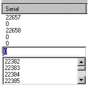
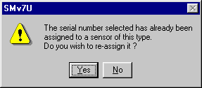

# Sensors & Actuators - Serial Numbers

Assign calibration data to sensors or actuators:

1. Open the [Sensors & Actuators dialog box](sensors-and-actuators-dialog-box.md).
2. Select the tab on which the device is listed.
3. Select the row for the device. If you select more than one row, using the CTRL and SHIFT keys, sequential serial numbers can be assigned automatically.
4. Click the serial number cell on that row to open a text box. To open the text box with the keyboard, type any number. To assign sequential serial numbers to multiple devices, type any number to open a text box for the top row of the selection.

    

5. Select a serial number from the drop-down list. Using the drop-down list is recommended, as it only includes valid numbers for calibrated sensors. Uncalibrated sensors may be given any serial number. When the text box is open, you can use the UP and DOWN cursor keys to select a number.
6. To accept the selected serial number, press ENTER or double-click the number. To leave the row without changing the value, press ESC or click another row.
7. Repeat from step 2 until you have completed all the allocations.
8. Save the file.
9. Select **Sensors** > **Sensor Set Download** to send the changes to the ECU.

If more than one row is selected, the first item is assigned the chosen serial number and each subsequent item is given a number one higher, if it is available. If a serial number is not available, 0 is assigned to that device. If 0 is entered for the first device, all the selected devices are assigned 0.

A serial number can only be assigned to one sensor of a given Type. If you choose a serial number that is already assigned to another sensor of that type, the following warning is displayed:

- Select **Yes** to assign the serial number to the newly selected sensor. The sensor that previously had that number is assigned a serial number of 0.
- Select **No** to assign a serial number of 0 to the newly selected sensor. The serial number stays with the sensor it was previously assigned to.

If the calibration database reports a problem with the sensor that has the chosen serial number (for example, a reported error that has not been confirmed, a sensor that should no longer be used or should be returned, or modified data), a warning is displayed and you are asked whether to proceed with the assignment.

!!! note
    A serial number can also be assigned to a sensor by the [External Inputs Configuration](../external-inputs/external-inputs-configuration.md). This is not linked to Sensors & Actuators, so you are not prevented from using the serial number more than once.

    Injectors have a further Class characteristic, which is associated with the serial number. System Monitor ensures that injectors of the same Type on the same controller also have the same Class; if the class of the selected injector does not match, you are asked whether to clear the other injectors on that controller.

**See also:** [Sensors & Actuators](index.md); [Sensors & Actuators dialog box](sensors-and-actuators-dialog-box.md)
