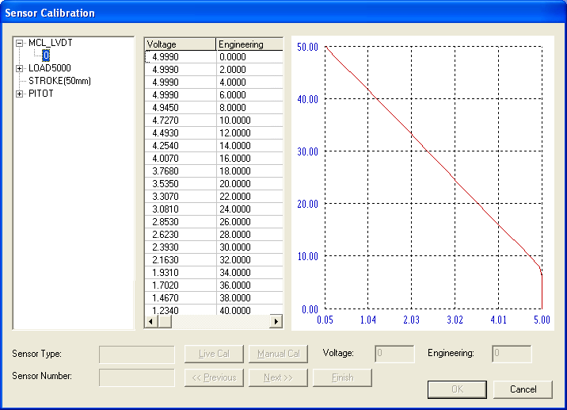

# Sensor Calibration Tool

The Sensor Calibration tool allows sensor calibration curves to be viewed and edited. To open the Sensor Calibration dialog box select **Sensors** > **Live Calibration...** (CTRL+SHIFT+F8). If the ECU is On-Line, the Select Live Calibration Parameter dialog box is displayed first (see [Live Calibration](live-calibration.md)). If you do not need live calibration, click **Cancel** to go straight to the Sensor Calibration dialog box.

The dialog box has three panes:

- The left-hand pane lists the sensor types from the .prm file (see [Calibration Files](calibration-files.md)). Only sensor types with calibration data are shown. Expand a type to show the serial numbers of the individual sensors of that type; if a type cannot be expanded, the default calibration is used. The selected **Sensor Type** and **Sensor Number** are shown in the boxes at the bottom of the dialog box. Right-click a sensor type and select **New Serial Number** to add a serial number.
- The centre pane shows the calibration data for the selected sensor, taken from the .dat file. The columns are:
    - **Voltage** (Breakpoint) - The output of the sensor in volts. Only sensors with a 0 to 5 V output are supported; other sensors require an interface amplifier.
    - **Value** - The quantity, in engineering units, associated with the output of the sensor. For example, a pressure sensor with a range of 0 to 10 bar may have a value of 10 at 5 V, 5 at 2.5 V and 0 at 0 V.
- The right-hand pane shows the same data as a graph. The graph is also shown for a selected sensor in [External Inputs - Adding a Sensor](../external-inputs/external-inputs-adding-a-sensor.md).

The buttons are:

| Button | Description |
|---|---|
| **Live Cal** | Starts a live calibration, in which the **Voltage** is read from the sensor. Only available if a live calibration parameter was selected. See [Live Calibration](live-calibration.md). |
| **Manual Cal** | Starts a manual calibration: the existing points are cleared and you enter the **Voltage** and **Engineering** value of each point yourself. |
| **<< Previous** / **Next >>** | Move to the previous or next calibration point. |
| **Finish** | Finishes the calibration. You are asked whether to accept the new calibration values. |
| **OK** | Saves the changes to the .dat files and closes the dialog box. |
| **Cancel** | Discards the changes. |

**See also:** [Software Calibrated Sensors](index.md); [Live Calibration](live-calibration.md)
