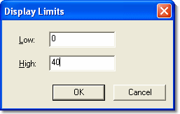

# Bar Graph - Display Limits

The **Display Limits** dialog box allows you to change the Maximum and Minimum values displayed on the Bar of a Bar Graph window for the selected Parameter.

To open the dialog box, right-click the bar and select **Display Limits** from the Bar Graph Context Menu.

To change the limits, edit the **Low** and **High** values as required and click **OK**.

The default values are the Upper and Lower Engineering Limits for the Parameter as set in the [Conversion](../../using-system-monitor/parameters/parameter-properties/conversion-tab.md) tab of the Parameter Properties dialog box.

**See also:** [Bar Graph](bar-graph.md); [Bar Graph - Selecting Parameters](bar-graph-selecting-parameters.md)
