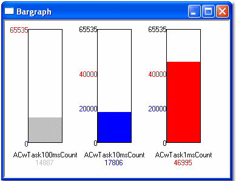

# Bar Graph

The Bar Graph Display shows one or more Measurement Parameters. Each parameter is displayed as a bar. A Bar Graph Display window can contain any number of Measurement Parameters.

To create a Bar Graph Window, select **Desktop** > **Window** > **Bar graph** (Alt+Shift+A).

Controls for the appearance and update rate of the Window are on the [Display](../../using-system-monitor/windows/using-windows/window-properties-display-tab.md) and **Extras** tabs of the Window Properties dialog box and on the Window System Menu.

## Features

The following features appear for each Parameter:

### Bar

The height of the bar is proportional to the value of the parameter. The colour of the bar depends on the value of the parameter. Three colours are possible:

| Colour | When used |
|---|---|
| **Bar** | The value is between the High and Low warning limits. Default: the Windows inactive-border system colour (usually grey). |
| **Limit warning 1** | Default Red. By default used when the value is above the High warning limit. |
| **Limit warning 2** | Default Blue. By default used when the value is below the Low warning limit. |

- The colours are set for the Window in the [Display](../../using-system-monitor/windows/using-windows/window-properties-display-tab.md) tab of the Window Properties dialog box. Which limit colour is used above and below the limits is set for each Parameter in the [Display](../../using-system-monitor/parameters/parameter-properties/display-tab.md) tab of the Parameter Properties dialog box.
- The bars are sized automatically to fit the Window.
- Bars are normally vertical but change to horizontal if **Orientation** is selected in the [Window System Menu](../../using-system-monitor/menus/window-system-menu.md), or if **Horizontal** is selected in the **Extras** tab of the Window Properties dialog box.
- When **Fill Window** is selected in the System Menu, the bars fill the whole Window, the limit values and names are not shown and the value is shown in the Foreground colour.

### Max/Min

The Maximum and Minimum values are shown at the ends of the bar. The colour of the text is the Foreground colour as set for the Window in the [Display](../../using-system-monitor/windows/using-windows/window-properties-display-tab.md) tab of the Window Properties dialog box. The Max/Min values can be changed, see [Bar Graph - Display Limits](bar-graph-display-limits.md).

### Warning Limits

The Warning limit values are shown beside the bar at their position on the scale, in the **Limit warning 1** (High) and **Limit warning 2** (Low) colours. The values are the High and Low Warning Limits for the Parameter as set in the [Display](../../using-system-monitor/parameters/parameter-properties/display-tab.md) tab of the Parameter Properties dialog box.

### Name/Description

The [Name or Description](../../using-system-monitor/parameters/names-descriptions-and-groups.md) of the Parameter is shown by the bar. The choice of Name, Description or None is set with **Names** in the [Parameters](../../using-system-monitor/parameters/selecting-parameters/multiple-parameter-selection-window-properties.md) tab of the Window Properties dialog box.

### Value

The value of the Parameter is shown with its units at the bottom of the bar. The colour of the text is the same as the colour of the bar. The value is shown in Engineering format by default; **Raw Hexadecimal** or **Raw Binary** can be selected from the System Menu. If the parameter in the display window does not appear in the [Live Logging Configuration](../../data-acquisition/logging/live-logging/index.md) parameter list, the value is not acquired from the control unit. In this case, the value is replaced by a dash.

**See also:** [Bar Graph - Selecting Parameters](bar-graph-selecting-parameters.md); [Bar Graph - Display Limits](bar-graph-display-limits.md); [Creating Windows](../../using-system-monitor/windows/creating-windows/index.md); [Data Display](../index.md); [Measurement Parameters](../../using-system-monitor/parameters/measurement-parameters.md)
