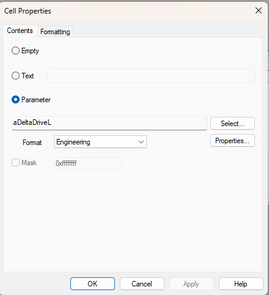

# Cell Properties - Contents

Use the **Contents** tab of the Cell Properties dialog box to enter or edit the contents of a cell.

Each cell in the [Grid](grid.md) can contain a parameter attribute, text or nothing. Select the type of content by selecting **Empty**, **Text** or **Parameter**.

## Empty selected

If **Empty** is selected, any existing cell content is deleted when **OK** is clicked. This is the same as pressing the DELETE key.

## Text selected

If **Text** is selected, free text can be entered in the text field. Alternatively, text can be entered directly into a cell in the grid.

## Parameter selected

If **Parameter** is selected, a Measurement or Scalar Parameter can be selected for display in the cell.

- **Select** - Opens the [Select Parameter](../../using-system-monitor/parameters/selecting-parameters/selecting-a-single-parameter.md) dialog box. If the selected cell already contains a Parameter, use this to select a new Parameter to display in the cell.
- **Properties** - Opens the Parameter Properties dialog box for the selected Parameter.
- **Format** - Each cell can display one attribute of the selected Parameter. The attribute is selected from the **Format** drop-down list. When a Parameter is first selected for a cell, **Name** is selected.

The following attributes are available for display:

| Format | Description |
|---|---|
| **Name** | The parameter Name. |
| **Units** | The symbol or text that indicates the Engineering units being used. |
| **Raw Value** | The raw value of the Parameter in hexadecimal format. |
| **Engineering** | The value of the Parameter displayed using the Format and [Conversion](../../using-system-monitor/parameters/parameter-properties/conversions/conversion-properties.md) defined in the Parameter Properties. |
| **Binary** | The raw value of the Parameter in binary format. |
| **Decimal** | The raw value of the Parameter in decimal format. |
| **Description** | The parameter Description. |
| **Slider** | Scalar Parameters only (not available for a Parameter with a text conversion). Shows a slider for changing the value. Set the **min** and **max** of the **Slider Range**; max must be greater than min. |
| **Button** | Scalar Parameters only. Shows a toggle button that switches the Parameter between **Value 1** and **Value 2**. For a Parameter with a text conversion, the values are selected from lists. Select **Set initial parameter value to value 1** or **value 2**. |
| **Trend** | Measurement Parameters only. A symbol that shows the status of the value (see below). |
| **Error** | Measurement Parameters only. Shows  when the parameter is reporting an error condition. |
| **Status** | Measurement Parameters only. See [Status cells](#status-cells). |

The Trend symbols are:

-  - The parameter value has increased since the window was last updated.
-  - The parameter value has decreased since the window was last updated.
- No icon - The value has not changed.

Values outside the Parameter's warning limits are shown in the **Limit warning** colours set in the [Display](../../using-system-monitor/windows/using-windows/window-properties-display-tab.md) tab of the Window Properties dialog box. Slider and Button cells, and Editable Parameter values, can only be changed when [Edit Mode](grid-window-edit-mode.md) is off.

!!! note
    The displayed attribute can be changed at any time by selecting a different one from the **Format** drop-down list or from **Data Format** in the Grid Cell Context menu.

## Mask

Grid window cells can display single or masked bit values from Measurement Parameters. The **Mask** check box is enabled when **Engineering** is selected in the **Format** drop-down list for a Measurement Parameter that is not a floating-point type. The value displayed is the Parameter's default Bit Mask value. To change it, select the **Mask** check box and enter a new hexadecimal value.

## Status cells

When **Status** is selected, the cell shows the text from the Parameter's text conversion that matches the value in the mask field. The cell background colour then shows whether the bits in the mask are in the required state in the current value of the Parameter. Select the required state from **Status mode**:

- **No bits set = OK**
- **Any bits set = OK**
- **All bits set = OK**

**Auto Generate** in the Grid Cell Context menu creates a set of Status cells, one for each entry in a Parameter's text conversion. See [Cell Properties](cell-properties.md#grid-cell-context-menu).

## Action Buttons

A cell can be turned into a button by selecting **Action Button** from the Grid Cell Context menu (single cell only):

- **Single Message** - Opens the Single Message dialog box to set the button text and the message to send to the unit when the button is clicked.
- **Run Script** - Opens the **Run Script** dialog box. Enter the **Button Text**, the **Command** (or click **...** to browse), any **Arguments** and the **Working Dir**. A command with the `.bas` extension is run as a SAX Basic script; any other command is run as a program. Relative paths are resolved from the project folder.

To edit an Action Button, select the same **Action Button** item again or select **Properties**.

**See also:** [Cell Properties](cell-properties.md); [Cell Properties - Formatting](cell-properties-formatting.md); [Editable Parameters](../../using-system-monitor/parameters/editable-parameters.md)
