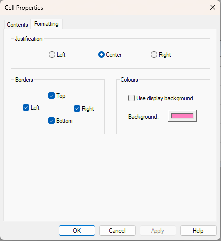

# Cell Properties - Formatting

Use the **Formatting** tab of the Cell Properties dialog box to change the justification, borders or background colour of a single cell. (Cells can also be formatted with the Grid Cell Context menu, which operates on single or multiple cells.)

## Justification

Select **Left**, **Center** or **Right**.

!!! note
    The **Trend** and **Error** symbols are always left justified. They are not affected by the justification setting.

## Borders

Use the **Left**, **Top**, **Bottom** and **Right** check boxes to add a thick border to that side of the selected cell.

!!! note
    These borders remain even if gridlines are switched off in the Window Properties dialog box.

## Colours

Set the cell background colour.

- **Use display background** - When selected, the cell uses the background colour set in the Window Properties dialog box. When cleared, the **Background** colour button is enabled.
- **Background** - Use this button to select a colour to use as a background for the selected cell.

**See also:** [Cell Properties](cell-properties.md); [Cell Properties - Contents](cell-properties-contents.md)
