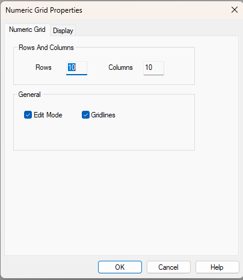

# Creating a Grid Window

To create an empty Grid Window, select **Desktop** > **Window** > **Grid** (Alt+Shift+G). This opens the **Numeric Grid** tab of the Window Properties dialog box.

## Rows And Columns panel

Enter the number of **Rows** and **Columns** you want to appear in the grid (default 10 of each).

You can change the number of rows and columns in the grid at any time. Rows or Columns can also be inserted or deleted at a cell location using the Grid Cell Context Menu (see [Insert Columns/Rows](insert-columns-rows.md) and [Delete Columns/Rows](delete-columns-rows.md)).

!!! note
    If you delete Rows or Columns that have entries in them, the entries are lost.

## General panel

- **Edit Mode** - When selected, the content and format of the cells can be modified. Default on for a new Grid Window. See [Grid Window Edit Mode](grid-window-edit-mode.md).
- **Gridlines** - When selected, gridlines are shown. Default on.

Click **OK** to open a new empty Grid Window on the current Page.

To use the Grid Window, you have to edit the [Properties](cell-properties.md) of each cell.

!!! tip
    To create a Grid Window from a layout previously saved with **Export**, select **Desktop** > **Window** > **Grid from Import**.

**See also:** [Grid](grid.md); [Cell Properties](cell-properties.md)
