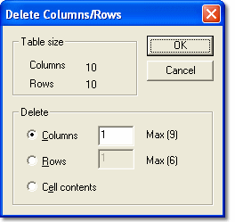

# Delete Columns/Rows

To delete a Row or Column, select **Delete** from the Grid Cell Context Menu to open the **Delete Columns/Rows** dialog box.

- The **Table size** panel is read only. It shows the number of Columns and Rows in the existing Window.
- Use the **Delete** panel to select whether to delete **Columns**, **Rows** or **Cell contents**, and to specify how many Columns or Rows to delete. The Column or Row that contains the current cell is deleted. Additional Columns are deleted to the right and additional Rows are deleted below. The maximum number that can be deleted (shown beside each field) ensures that at least one Row and one Column remain.
- Deleting **Rows** and **Columns** only operates on the current cell, even if multiple cells are selected.
- Deleting **Cell contents** applies to all selected cells.

The size of the Grid can also be edited on the [Numeric Grid](creating-a-grid-window.md) tab of the [Window Properties](../../using-system-monitor/windows/using-windows/window-properties.md) dialog box.

**See also:** [Creating a Grid Window](creating-a-grid-window.md); [Insert Columns/Rows](insert-columns-rows.md); [Selecting Cells](selecting-cells.md); [Window Properties](../../using-system-monitor/windows/using-windows/window-properties.md)
