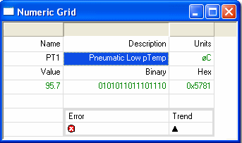

# Grid

The Numeric Grid is a free-form display which allows text and various attributes of any number of Measurement or Scalar Parameters to be placed in cells in a spreadsheet-style table.

Grid Displays are typically used to provide customised views of data to suit various operations. Motion Applied customer support teams can prepare Desktop files that contain customised Grid Displays to assist in setting up specific items of equipment.

## Features

- Grid Displays can duplicate the appearance and function of the custom pages used in System Monitor Version 6.
- To prevent accidental changes to the grid format, open the Window Properties dialog box and clear the **Edit Mode** check box on the **Numeric Grid** tab. See [Grid Window Edit Mode](grid-window-edit-mode.md).
- Editable Parameters can be edited in a Grid Display when Edit Mode is off. Editable Parameters can be highlighted by showing them on a different background colour. To do this, open the Window Properties dialog box, click the **Display** tab and set the **Edit Params** colour to be different from the **Background** colour.
- A cell can also show a Scalar Parameter as a **Slider** or a toggle **Button**, a Measurement Parameter's bits as a **Status** indicator, or an **Action Button** that sends a Single Message or runs a script. See [Cell Properties - Contents](cell-properties-contents.md).
- If the parameter associated with the displayed value in a cell does not appear in the [Live Logging Configuration](../../data-acquisition/logging/live-logging/index.md) parameter list, the value is not acquired from the control unit. In this case, the value is represented by a dash.
- A Grid layout can be exported to, and imported from, an XML file with **Export** and **Import** in the [System Menu](system-menu-grid.md). To create a new Grid Window from an exported file, select **Desktop** > **Window** > **Grid from Import**.
- Controls for the appearance of the Window are available on the Window Properties dialog box and on the [System Menu](system-menu-grid.md).

**See also:** [Creating a Grid Window](creating-a-grid-window.md); [Data Display](../index.md); [Editable Parameters](../../using-system-monitor/parameters/editable-parameters.md)
