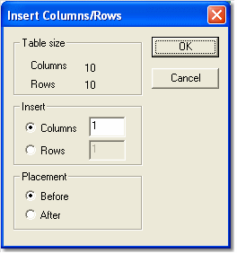

# Insert Columns/Rows

To insert a Row or Column, select **Insert** from the Grid Cell Context menu to open the **Insert Columns/Rows** dialog box.

- The **Table size** panel is read only. It shows the number of Columns and Rows in the existing Window. The size of the grid can also be changed in the **Numeric Grid** tab of the Window Properties dialog box.
- In the **Insert** panel, select whether you want to insert **Columns** or **Rows** and enter how many to add.
- In the **Placement** panel, select whether the new Rows or Columns are inserted **Before** or **After** the current cell. If multiple cells are selected, placement is relative to the current cell only.

**See also:** [Creating a Grid Window](creating-a-grid-window.md); [Delete Columns/Rows](delete-columns-rows.md); [Selecting Cells](selecting-cells.md); [Window Properties](../../using-system-monitor/windows/using-windows/window-properties.md)
