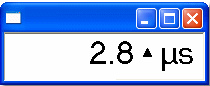

# Big Number

The **Big Number** Display is a type of the [Numeric](numeric.md) Display. It is created when you create a Window with the Parameter Explorer for a single Measurement Parameter.

## Features

The Big Number Display differs from the Numeric Display in the following ways:

- The text is in the default large font.
- The Name and Description columns are not shown; only the value, status symbol and units are shown.
- The Parameter Name and/or Description is shown in the Title bar.
- The Column Headings are hidden.

!!! note
    **Desktop** > **Window** > **Big Number** (Alt+Shift+B) is listed in the menu but is not available. Use the Parameter Explorer to create a Big Number Display, or select **Large Font** from the System Menu of a Numeric Window.

**See also:** [Measurement Parameters](../../using-system-monitor/parameters/measurement-parameters.md); [Numeric](numeric.md)
