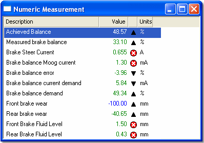

# Numeric

The Numeric Display shows one or more [Measurement Parameters](../../using-system-monitor/parameters/measurement-parameters.md). Each parameter is displayed in a row with descriptive text. A Numeric Display window can contain any number of Measurement Parameters.

To create a Numeric Window, select **Desktop** > **Window** > **Numeric** (Alt+Shift+N).

If you create a Window with the Parameter Explorer for a single Measurement Parameter, a [Big Number](big-number.md) Display is created. The Big Number is a type of Numeric Display.

## Columns

Each Measurement Parameter is displayed as a row with the following columns:

| Column | Description |
|---|---|
| **Name** / **Description** | The Name, the Description, both or neither may be displayed for each Parameter. This is set with **Names** in the [Parameters](../../using-system-monitor/parameters/selecting-parameters/multiple-parameter-selection-window-properties.md) tab of the Window Properties dialog box. |
| **Value** | The value of the Parameter. The format (Engineering, Raw hexadecimal, Raw binary or Raw decimal) is set in the Parameters tab of the Window Properties dialog box or in the System Menu. When the value is outside the Parameter's warning limits it is shown in the **Limit warning 1** or **Limit warning 2** colour, set for the Window in the [Display](../../using-system-monitor/windows/using-windows/window-properties-display-tab.md) tab of the Window Properties dialog box. |
| (unlabelled) | A symbol that shows the status of the value (see below). |
| **Units** | A symbol or text that indicates the Engineering units used by the value. |

The status symbols are:

-  - The parameter value has increased since the window was last updated.
-  - The parameter value has decreased since the window was last updated.
-  - The parameter is reporting an error condition.
- No icon - The value has not changed.

For a [Locked Parameter](../../using-system-monitor/parameters/locked-parameters/locked-parameters.md), a locked symbol is shown and the value is replaced by a dash.

## Features

- Column widths can be changed and the Parameters sorted. See [Columns in Tabular Windows](../../using-system-monitor/windows/using-windows/columns-in-tabular-windows.md).
- If the parameter in the display window does not appear in the [Live Logging Configuration](../../data-acquisition/logging/live-logging/index.md) parameter list, the value is not acquired from the control unit. In this case, the value is replaced by a dash.
- In addition to the standard commands, the System Menu has **Engineering**, **Raw Hexadecimal**, **Raw Binary** and **Raw Decimal** (value format), **Zero All Values** (Alt+Z), **Clear All Display Offsets** (Alt+D), **Normal Font**, **Large Font** and **Show Column Headings**.
- To change the appearance of the Window, configure options on the [Display](../../using-system-monitor/windows/using-windows/window-properties-display-tab.md) tab of the Window Properties dialog box.

**See also:** [Creating Windows](../../using-system-monitor/windows/creating-windows/index.md); [Data Display](../index.md); [Measurement Parameters](../../using-system-monitor/parameters/measurement-parameters.md); [Window Properties](../../using-system-monitor/windows/using-windows/window-properties.md)
