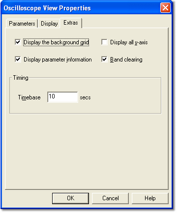

# Oscilloscope - Extras

Use the **Extras** tab of the [Window Properties](../../using-system-monitor/windows/using-windows/window-properties.md) dialog box to modify the appearance of the Oscilloscope Display.

| Option | Description | Default |
|---|---|---|
| **Display the background grid** | When selected, a grid is shown on the [Plot Area](oscilloscope-plot-area.md). | On |
| **Display all y-axis** | When selected, a labelled Y-axis is shown for all the Parameters in the Window. When cleared, the Y-axis is only shown for the Parameter(s) selected in the Parameter Info Box. The Y-axis is not displayed for Parameters with a Logical trace type. | Off |
| **Display parameter information** | When selected, the [Parameter Info](oscilloscope-parameter-info.md) Box is shown. | On |
| **Band clearing** | When selected, the traces from the previous sweep are left on the Plot Area and are overwritten by new data. The progress of the update is shown by a band moving across the plot. When cleared, the Plot Area is cleared for each sweep. | On |

These four options are also available in the [Oscilloscope System Menu](system-menu-oscilloscope.md).

## Timing panel

The length of the Timebase (X-axis) in the Plot Area can be changed by entering a new **Timebase** value, in seconds. The default is 10 seconds; the value must be between 5 and 60 seconds.

**See also:** [Oscilloscope](oscilloscope.md); [Oscilloscope - Plot Area](oscilloscope-plot-area.md)
